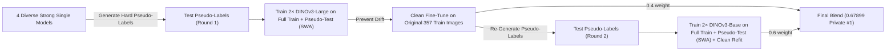

# CSIRO - Image2Biomass Prediction — Top 8 Solutions & Post-Mortem

> **Competition**: [CSIRO - Image2Biomass Prediction](https://www.kaggle.com/competitions/csiro-biomass) (Oct 2025 – Jan 29, 2026 | 3,805 Teams | \$75,000 Prize Pool)  
> **Task**: Multi-Target Top-View Pasture Biomass Image Regression (`5` correlated gram targets)  
> **Evaluation Metric**: Globally Weighted $R^2$ ($R_w^2$) across all `(image, target)` rows combined  
> **Dataset**: 357 Train Images (`2000 × 1000` JPEG, 1,785 rows + metadata) | >800 Hidden Test Images (**zero metadata at test time**)  
> **LB Split**: ~53% Public / ~47% Private (Severe Public-to-Private Shakeup: Public #1–#3 dropped 35–39 spots)

---

## Official Top 8 Leaderboard Standings & Solution Index

The CSIRO challenge became a landmark 2026 Computer Vision case study in **small-sample domain shift (`357` train images vs. `>800` hidden test images)**, **DINOv3 dense patch-token dominance**, and **test-time adaptation / pseudo-labeling under heavy shakeup**:

| Private Rank | Team / Competitor | Public Rank & LB | Private LB | Δ Rank | Core Winning Paradigm | Writeup / Code |
| :---: | :--- | :---: | :---: | :---: | :--- | :--- |
| 🥇 **#1** | **`卷不动了`** (`pingfan`, `leehann`, `tianhengqiu`, `zxc123cc`) | #12 (0.77736) | **0.67899** | +11 | Dual-stream `1024px` DINOv3-Large + MHSA + **5 UEPNet 7-bin cls + 5 reg heads** + **2-stage Test-Time Online Training (TTT)** w/ SWA + clean refit | [Writeup](https://www.kaggle.com/competitions/csiro-biomass/writeups/1st-place-solution) · [Notebook](https://www.kaggle.com/code/pingfan/lb0-77-pb-0-67-1-debug-infer-two-gpus-v1-d45a08?scriptVersionId=294488905) |
| 🥈 **#2** | **`dino series`** (Quan Vu / `quan0095`) | #9 (0.77937) | **0.67558** | +7 | DINOv3-Large/Huge **weakly-supervised `DPTHead` (`[4,11,17,23]`) + `Conv-ReLU`** + Qwen-Edit pseudo-labeled & bare-soil synthetic aug + **per-target early-stop checkpoints** + State-aware PP (`WA dead=0`) | [Writeup](https://www.kaggle.com/competitions/csiro-biomass/writeups/2nd-weakly-supervised-semantic-segmentation-sy) · [GitHub](https://github.com/quanvuhust/csiro) |
| 🥉 **#3** | **`embee`** (Mayukh Bhattacharyya / `mayukh18`) | #37 (0.75744) | **0.66942** | +34 | 19-model ensemble across `GroupKFold(Date)` & **Embedding-Distance Easy/Hard CV**; 3-backbone (`DINOv3-Huge+`, `ConvNeXtV2-L`, `ViT-MAE`) + `LocalMamba` fusion; vertical 4-segment permutation + no TTA | [Writeup](https://www.kaggle.com/competitions/csiro-biomass/writeups/3rd-place-solution) · [Notebook](https://www.kaggle.com/code/mayukh18/dinov3-no-tta-postprocess) |
| 🏅 **#4** | **`yanqiangmiffy`** (`quincyqiang`) | #25 (0.76673) | **0.66177** | +21 | 3-stream (`left/right/full` `1024px`) DINOv3-Large + **`MetaMoE` Heteroscedastic `GaussianNLLLoss` with physics identities** + HSV timestamp inpainting + 6-model ensemble + State PP | [Writeup](https://www.kaggle.com/competitions/csiro-biomass/writeups/physics-constrained-regression-integrating-biolog) · [GitHub](https://github.com/yanqiangmiffy/2025-Kaggle-CSIRO-5th-solution) |
| 🏅 **#5** | **`Kinosuke`** (`chiman3se`) | #35 (0.75859) | **0.66172** | +30 | **Image & Label Halving** (`2×` samples) + **CLS-free `Conv1×1 -> Softplus -> Sum` Density-Only Head** on DINOv3-L/Huge+ (`672–960px`) + gradual top-50% unfreeze with linearly rising LR | [Writeup](https://www.kaggle.com/competitions/csiro-biomass/writeups/5th-place-solution) |
| 🏅 **#6** | **`Orion`** (Sayaka Miki / `linkinpony`) | #8 (0.78071) | **0.65807** | +2 | Frozen/LoRA **`dinov3_vit7b16` (ViT-7B)** `[23,31,39]` + ViTDet `SimpleFeaturePyramid` + total×simplex parameterization + Manifold Mixup + UW + PCGrad + 64-sample MC-dropout weighting | [Writeup](https://www.kaggle.com/competitions/csiro-biomass/writeups/a-scalar-regression-pipeline-based-on-dinov3) · [PDF](https://github.com/LinkinPony/CSIRO/blob/main/docs/writeup.pdf) |
| 🏅 **#7** | **`Genius Seed is all you need`** (`shanzhong8` et al.) | #16 (0.77502) | **0.65668** | +9 | `StratifiedGroupKFold` (WA split into 7 virtual dates, 10M-seed search) + single/dual-stream DINOv3-Large (80% frozen) + $R^2$ loss + SWA + **Stage-2 TTT blend (`0.2/0.8`)** | [Writeup](https://www.kaggle.com/competitions/csiro-biomass/writeups/8th-place-solution-singledual-ttt) · [Notebook](https://www.kaggle.com/code/cudacoding/speedup-ttt-fold2-w-o-pp-lb-0-77-0-65) |
| 🏅 **#8** | **`PixelScale 🌿`** (Paritosh Kumar Tripathi et al.) | #27 (0.76430) | **0.65198** | +19 | 3-pipeline blend: **Significant Subspace Alignment (SSA)** TTA on DINOv3-Huge+ (`50%`) + 2-stage Species-aware (`30%`) + Dual-backbone DINOv3-Huge+/SigLIP-SO400M (`20%`) | [Writeup](https://www.kaggle.com/competitions/csiro-biomass/writeups/8th-place-solution-csiro-image2biomass) |

*(Shakeup benchmark: Public #1 `Marco Ledda` `0.81038` → Private #40 `0.63603` `[-39]`; Public #2 `M & F` `0.79490` → Private #37 `0.63729` `[-35]`; Public #3 `Grassworks by K&A` `0.79394` → Private #38 `0.63670` `[-35]`.)*

---

## 1. Competition DNA, Metric Mathematics & Data Forensics

### 1.1 Evaluation Metric & Physical Identities
Submissions were scored by **Globally Weighted $R^2$** over all 5 target rows stacked together (not the mean of 5 per-target $R^2$ scores):

$$R_w^2 = 1 - \frac{\sum_{j} w_j (y_j - \hat{y}_j)^2}{\sum_{j} w_j (y_j - \bar{y}_w)^2}, \qquad \bar{y}_w = \frac{\sum_j w_j y_j}{\sum_j w_j}$$

| Target Column | Weight ($w_j$) | Physical Meaning & Identity | Train Max (g) |
| :--- | :---: | :--- | :---: |
| `Dry_Total_g` | **0.50** | Total dry biomass (`GDM_g + Dry_Dead_g`) | `185.70` |
| `GDM_g` | **0.20** | Green dry matter (`Dry_Green_g + Dry_Clover_g`) | `157.98` |
| `Dry_Green_g` | **0.10** | Dry green vegetation excluding clover | `157.98` |
| `Dry_Dead_g` | **0.10** | Dry dead material / senesced litter | `83.84` |
| `Dry_Clover_g` | **0.10** | Dry clover biomass | `71.79` |

Because `Dry_Total_g` has both the largest scale (up to `185.7g`) and **50% of the global squared-error weight**, errors on high-biomass `Dry_Total_g` samples dominate $R_w^2$ far more than errors on `Dry_Clover_g`.

### 1.2 Crucial Dataset Quirks & Domain Shift Forensics
1. **Extreme Small-N vs. Hidden Test Ratio**: Only **357 training images** (`2000 × 1000` top-down photos over $0.7\text{ m} \times 0.3\text{ m} = 0.21\text{ m}^2$ quadrats) vs. **>800 hidden test images** spanning different sampling dates, lighting, and seasonal regimes.
2. **Train-Only Metadata Trap**: `train.csv` included `Sampling_Date`, `State` (`Tas=138, Vic=112, NSW=75, WA=32`), `Species` (15 species combinations), `Pre_GSHH_NDVI`, and `Height_Ave_cm`, whereas **`test.csv` provided images only**.
3. **Regional Zero-Target Structure (`State` Forensics — 2nd & 4th Place)**:
   - An image classifier predicts `State` with **>98% accuracy** from soil/pasture texture alone.
   - In **Western Australia (`WA`, 32 train samples)**, `Dry_Dead_g == 0.0000` for **100% of samples** (so `Dry_Total_g == GDM_g`).
   - In **New South Wales (`NSW`, 75 train samples)**, `Dry_Clover_g` never exceeds `10.10g` (mean `0.13g`), while `Dry_Green_g` averages `56.56g`.
4. **Camera Artifacts**: Several images contain bright orange embedded camera timestamps (`HSV [5,150,150]–[25,255,255]`), which 4th place removed via morphological dilation + `cv2.inpaint(..., CV2.INPAINT_TELEA)`.
5. **Why Public LB Overfit Catastrophically**: Public LB (`0.77–0.81`) sat **~0.10–0.15 higher** than Private LB (`0.65–0.68`), indicating substantial seasonal/site distribution shift between the Public and Private test subsets. Teams that over-tuned thresholds, post-processing multipliers, or small-backbone hyperparams to Public LB plummeted 30–40 places.

---

## 2. Backbone & Spatial Architecture Breakthroughs

### 2.1 Unanimous DINOv3 Supremacy
Every single top-8 team converged on **DINOv3** (`vit_large_patch16_dinov3_qkvb`, `vit_huge_plus_patch16_dinov3`, `dinov3_vit7b16`). Controlled ablations from 2nd, 5th, and 8th place demonstrated a dramatic performance gap over language-supervised and CNN backbones:

| Backbone Family (5th Place Controlled Pipeline) | Local CV | Public LB | Private LB |
| :--- | :---: | :---: | :---: |
| `SigLIP` | 0.75 | 0.66 | 0.550 |
| `EVA02-CLIP` | 0.75 | 0.69 | 0.584 |
| `DINOv3` (Global CLS / Pooled Head) | 0.79 | 0.73 | 0.640 |
| **`DINOv3` (Dense Patch-Token Density Head)** | **0.81** | **0.75** | **0.660** |

*Why*: Biomass estimation depends on fine-grained dense foliage texture, canopy depth, and spatial coverage rather than high-level semantic object labels. Self-supervised DINOv3 patch tokens already linearly separate green foliage, clover, dead litter, and bare soil zero-shot (verified via patch PCA in 5th place).

### 2.2 Aspect-Ratio Preservation (`2000 × 1000` Geometry)
Squashing `2000 × 1000` images to squares severely degraded accuracy (4th place `exp-v97`: unsplit full image scored `0.52` LB). Top teams solved the `2:1` aspect ratio via three clean patterns:
1. **Dual-Stream Left/Right Square Split (1st, 2nd, 3rd, 7th, 8th)**: Split into two `1000 × 1000` halves resized to `640–1024px`, encode with a shared backbone, and fuse via **1-layer MHSA** (1st), **sum of left/right spatial density heads** (2nd), or **LocalMamba blocks** (3rd). 4th place added a 3rd resized `full` context stream.
2. **Image & Label Halving — Data Doubling (5th Place)**: Split each `2000 × 1000` photo into two independent `1000 × 1000` training examples with **all biomass labels divided by 2**, doubling effective training size from `357` to `714` images (`2×` samples, summed back at inference). This consistently beat dual-stream concatenation across DINOv3, EVA02-CLIP, and SigLIP.
3. **Native Rectangular Patch Grid (6th, 7th)**: Feed `960 × 480` (6th) or `2048 × 1024` (7th) directly into RoPE-enabled DINOv3 ViT without warping aspect ratio.

### 2.3 Four Distinct Winning Head Architectures
1. **UEPNet Hybrid Regression + Interval-Classification Head (1st Place — `+0.03` Pub & Priv LB)**:
   - Inspired by crowd counting (*Uniformity in Heterogeneity*, ICCV 2021), paired **5 independent 3-layer regression heads** with **5 7-interval classification heads** defined by binary-search target quantile borders (`SmoothL1Loss + 0.3 * CrossEntropyLoss`).
   - Crucially, **did NOT enforce hard physical sum constraints during training**, reducing train-distribution overfitting.
2. **Weakly-Supervised Dense Patch-Token Density Summation (2nd, 5th, 6th Place)**:
   - **5th Place (`Density-Only Head`)**: Discarded the CLS token entirely; mapped patch grid `[B, C, H_p, W_p]` through a single **`Conv2d(1×1, C → 5) → Softplus → Spatial Sum`** (only `6,405` parameters for ViT-Huge+!). Note: `Conv3×3` caused NaN instability; `Conv1×1` resolved it completely.
   - **2nd Place (`SegDINO / DPTHead`)**: Tapped intermediate ViT layers **`[4, 11, 17, 23]`** into a `DPTHead` producing 3-channel patch density heatmaps (`clover, dead, green`), pooling left and right tiles and summing (`main_logits_l + main_logits_r`).
   - **6th Place (`ViT-7B + ViTDet SimpleFeaturePyramid`)**: Tapped layers **`[23, 31, 39]`** of frozen/LoRA `dinov3_vit7b16` into multi-scale pyramids (`2×, 1×, 0.5×, 0.25×`) predicting total mass $t$ times a 3-way simplex composition $\text{softmax}(r)$.
3. **Heteroscedastic `MetaMoE` Physics-Consistent `GaussianNLLLoss` (4th Place)**:
   - 4-expert MoE head outputs both mean $\mu$ and variance $\sigma^2 = \text{softplus}(\text{var\_logit}) + 10^{-6}$ for `(total, gdm, green)`.
   - Derives `dead = total - gdm` (`var_dead = var_total + var_gdm`) and `clover = gdm - green` (`var_clover = var_gdm + var_green`), allowing `GaussianNLLLoss` to automatically downweight label outliers while respecting additivity.
4. **Multi-Backbone `LocalMamba` Fusion (3rd Place)**:
   - Combined `vit_huge_plus_patch16_dinov3` + `convnextv2_large` + `vit_base_patch16_224.mae`, applying two `LocalMambaBlock(kernel_size=5)` layers per backbone before Softplus heads.

---

## 3. Training Discipline, Regularization & Test-Time Adaptation

### 3.1 Preserving Pretrained Foundation Geometry (Small-N Critical Rule)
Full aggressive fine-tuning immediately destroyed DINOv3 representations on 357 images. Every medalist restricted backbone drift:
- **Two-Stage Freeze → Unfreeze** (1st, 5th, 8th): Train head alone for 5–15 epochs, then unfreeze full backbone at `0.1×` head LR (1st, 3rd, 4th) or **only the top 20%–50% of blocks** (5th, 7th).
- **Frozen / LoRA Adaptation** (6th): Freeze `ViT-7B` (`C=4096`), optionally add QKV LoRA only on the last 16 blocks.
- **Per-Target Checkpoint Early Stopping (2nd Place — `+0.0087` Private LB)**: Because `Dry_Green_g` peaked early (**epochs 11–15**) and overfit afterwards while `Dry_Clover_g` and `Dry_Dead_g` kept improving through **epochs 24–30**, loading epoch-15 weights for `green` and epoch-26 weights for `clover/dead` jumped Public `0.76128 → 0.76731` and Private `0.64744 → 0.65615`.
- **Schedule-Free & Weight Averaging**: 2nd place used `AdamWScheduleFree(wd=0.02, bs=2, backbone_lr=1e-5, head_lr=1.7e-5)`; 1st & 7th place relied heavily on **SWA** across final/top checkpoints.

### 3.2 Domain-Preserving Augmentations & Synthetic Data
- **Biomass-Invariant Spatial Permutations (3rd Place)**: Cutting images vertically into 4 strips and randomly permuting them + 50% left/right tile swap preserves exact total biomass while breaking positional memorization.
- **Scale & Occlusion**: `RandomResizedCrop(0.8–1.0)`, `RandomErasing(p=0.5)`, `MixUp/CutMix`, and random downscale (`0.85–1.0`) with black border padding to mimic camera height variation (1st).
- **Synthetic Data Rule (2nd Place)**: Using `Qwen Image Edit` to alter weather/add gravel **hurt LB when reusing original labels** (edits alter visible foliage). Two fixes worked: (1) **pseudo-label edited images** with a real-data teacher, and (2) erase all vegetation to create **bare soil images with exact `(0, 0, 0)` labels**.

### 3.3 Test-Time Online Training (TTT) & Subspace Alignment (The `+0.02` Shakeup Weapon)
With `>800` hidden test images (>2× the training set size) and clear test-set domain shift, adapting at inference time within the 9-hour GPU notebook budget was decisive:

1. **Two-Round TTT + Clean Refit (1st Place, `> +0.02` gain)**: Generating hard pseudo-labels from 4 diverse models → training 2× DINOv3-Large on `train + pseudo_test` with SWA → **clean fine-tuning on original train data** to purge pseudo-label bias → regenerating pseudo-labels for 2× DINOv3-Base → `0.4 * Large + 0.6 * Base`.
2. **Single-Round TTT Blend (7th Place)**: Stage-1 ensemble pseudo-labels (lightly post-processed: `clover *= 0.8`, zero `< 0.2`) → 12-epoch TTT with 4-epoch SWA → `0.2 * Stage1 + 0.8 * TTT`.
3. **Training-Free Feature Adaptation — Significant Subspace Alignment / SSA (8th Place, `+0.006` Private LB)**: Adapted a lightweight linear layer between frozen DINOv3-Huge+ and the MLP head at test time by aligning test feature subspace statistics to precomputed source PCA moments ($\mu_s, U$), lifting Private LB `0.646 → 0.652` with minimal compute.

---

## 4. Validation Strategy, Post-Processing & Shakeup Defense

### 4.1 Cross-Validation Dilemmas on 357 Grouped Images
- **Grouped vs. Stratified Trade-off**: Strict `GroupKFold(Sampling_Date)` or `(State, Sampling_Date)` exposed real domain shift (high fold variance; 7th place even split `WA`'s 3 dates into 7 virtual dates across 10M seed trials to form 5 balanced folds), while 5th place stratified by `clover_dead_presence` (`0_0, 0_1, 1_0, 1_1`) inside `StratifiedGroupKFold(Sampling_Date)`.
- **Easy vs. Hard Embedding-Distance Validation (3rd Place)**: Splitting each validation fold into bottom-50% (`easy`) and top-50% (`hard`) 5-NN Euclidean embedding distance to train revealed that **easy-subset CV tracked Public LB**, while heavy ensembling across both grouped and embedding-clustered CV schemes drove a **+34 rank Private LB surge**.

### 4.2 High-Impact Post-Processing (Competition-Specific vs. Structural)
- **Soft Additivity Reconciliation (1st Place, Structural)**: Averaging direct predictions with component sums (`0.5 * gdm + 0.5 * (green + clover)` and `0.5 * total + 0.5 * (green + clover + dead)`) reduced variance without hard-coupling training gradients.
- **State-Aware Post-Processing (2nd Place: Pub `0.76822 → 0.77937`, Priv `0.66153 → 0.67558`; 4th Place)**: Using a >98%-accurate image `State` classifier to enforce `Dry_Dead_g = 0` when `P(WA) > 0.75`, clipping to per-state/global training maxima, and applying conservative state/target scaling (`clover *= 0.8`, `dead > 20 *= 1.1`, `dead < 10 *= 0.9`). *(Competition-specific; must never be hardcoded blindly into future tasks.)*

---

## 5. Master Anti-Patterns & Empirical Negative Results

| Tested Hypothesis | Verified Outcome | Teams Reporting | Root Cause |
| :--- | :--- | :--- | :--- |
| **Chasing Single-Split Public LB** | Public #1–#3 fell **-35 to -39 ranks**; 6th place dropped a `0.69` Private model for a `0.78` Public model (`0.65` Private) | #6, LB Forensics | ~0.12 Public-to-Private domain shift made aggressive Public-LB model selection toxic |
| **Auxiliary Metadata Losses (`NDVI`, `Height`, `Species`, `State`)** | Hurt or negligible impact on primary biomass CV/LB | #2, #3, #5, #7 | Auxiliary gradients compete with scarce 357-sample visual capacity; metadata absent at test time |
| **Standard Test-Time Augmentation (HFlip/Multi-Crop TTA)** | Negligible or negative LB change (3rd place explicitly turned TTA **OFF**) | #2, #3, #5 | Small shifted test set + flip/crop averaging slightly shifts scale/calibration on $R^2$ |
| **Hard Physical Constraints During Training / Ratio Parameterization** | Hurt LB (1st); ratio prediction dropped CV `0.58 → 0.43` (4th `exp-v36`) | #1, #4 | Component errors propagate linearly into high-weight `Dry_Total_g` (`w=0.5`); ratios amplify small-denominator noise |
| **Naively Reusing Original Labels on Edited/Synthetic Images** | Degraded LB (DiffuseMix, un-pseudolabeled Qwen edits, external data) | #1, #2, #3, #7 | Generative edits silently change vegetation volume; pseudo-labeling or exact bare-soil `(0,0,0)` targets are required |
| **Hand-Cleaning Suspected Noisy Train Labels (`WA/2015-8-21`)** | Improved local CV, **hurt LB** | #5 | Test set shares the same measurement noise process as training labels |
| **Multi-Scale Patch Grids (`[1×2, 2×4, 4×8]`) / Unsplit Full Image** | `< 0.60` Private LB (1st); `0.52` LB (4th) | #1, #4 | Warping `2:1` geometry or fragmenting scale breaks quadrat areal density cues |
| **Complex SSL Schemes vs. Simple Hard Pseudo-Labeling** | All complex SSL variants lost to direct hard pseudo-labeling + clean refit | #1 | Small-N + shifted target domain favors straightforward two-stage hard TTT with clean-train anchoring |
