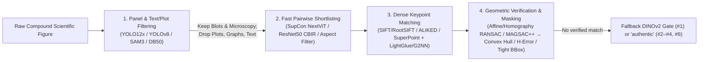

# Recod.ai/LUC — Scientific Image Forgery Detection: Top Solutions & Post-Mortem

> **Competition**: [Recod.ai/LUC - Scientific Image Forgery Detection](https://www.kaggle.com/competitions/recodai-luc-scientific-image-forgery-detection) (Oct 2025 – Apr 23, 2026 | 1,564 Teams, 1,193 Final LB | \$55,000 Prize Pool)  
> **Task**: Detect and segment copy-move image forgeries (highlighting **both source and duplicated regions**) in biomedical research figures  
> **Evaluation Metric**: Optimal Hungarian-matched Instance F1 (**`oF1`**) with excess-prediction penalty $G / \max(P, G)$; `"authentic"` exact match = `1.0`, false positive / false negative on authentic/forged = `0.0`  
> **Dataset**: `5,128` Train images (`2,377` authentic, `2,751` forged) + **`48` real-world multi-panel `supplemental_images`** | Two-phase Forecasting Test (~48% Public from retracted papers, ~52% newly collected Private; all-`"authentic"` baseline = **`0.30393`** Private)  
> **Runtime Constraint**: `<= 4h` (training phase) / `<= 9h` (forecasting rerun) notebook, internet disabled

---

## Official Top Leaderboard Standings & Solution Index

In a two-phase live forecasting competition with severe train-to-test shift (simple single-panel training images vs. compound multi-panel retracted-paper figures in test), **panel-first detection + retrieval/keypoint matching + geometric verification (`RANSAC`/`MAGSAC++`) swept 5 of the Top 6 spots**, while the lone pure deep-learning segmentation model in Top 6 survived only by scaling to **8-bit `DINOv3-7B`** validated strictly on the 48 supplemental images:

| Private Rank | Public Rank | Team / Author | Private LB | Public LB | Core Winning Paradigm | Writeup / Code |
| :---: | :---: | :--- | :---: | :---: | :--- | :--- |
| 🥇 **#1** | #1 | **Uladzislau Leketush** (`orshanec`) | **0.55056** | **0.45864** | **22.9M PMC-crawled panel corpus** + `YOLO12x` panel & **Western-blot lane detectors** (`+0.056` LB!) + `nextvit_small` **SupCon** embedders + `LightGlue` (`SIFT` microscopy / custom `ALIKED-n16` blots) + public DINOv2 fallback | [Writeup](https://www.kaggle.com/competitions/recodai-luc-scientific-image-forgery-detection/writeups/1st-place-solution) · [GitHub](https://github.com/vlad3996/forgeryscope) · [Notebook](https://www.kaggle.com/code/orshanec/1st-place-solution) |
| 🥈 **#2** | #3 | **`shiba-inu`** (`npinpi`) | **0.45250** | **0.39406** | **Pure Classical Matching + YOLO Preprocessing**: 5-seed `YOLOv8-m` (WBF) panel + text masker → ultra-dense **SIFT (`contrast=0.001`, 4× upscale)** + **G2NN FLANN** + dual Local/Global Affine RANSAC + HDBSCAN + H-error pixel refinement | [Writeup](https://www.kaggle.com/competitions/recodai-luc-scientific-image-forgery-detection/writeups/2nd-place-solutionsift-maching) · [GitHub](https://github.com/oshima-yoppi/luc_pub) · [Notebook](https://kaggle.com/code/npinpi/2nd-place-solution) |
| 🥉 **#3** | #9 | **CoreyJamesLevinson** (`returnofsputnik`) | **0.40023** | **0.35423** | **Zero-Training Pipeline**: Prompted **SAM3** panel & object segmentation + CLAHE + text/arrow blur → **SIFT + FLANN + Lowe's ratio + Homography RANSAC** → tight inlier bbox + deterministic crop fallback | [Writeup](https://www.kaggle.com/competitions/recodai-luc-scientific-image-forgery-detection/writeups/solution-public-lb-8th-place-private-lb-3rd-pla) |
| 🏅 **#4** | #1081 | **maruti boyane & Nivratti** (+1,077!) | **0.38321** | — | **`YOLOv5` panel detector** (Blots & Microscopy only; non-compound → `"authentic"`) → aspect/area + `ResNet-50` CBIR top-3 shortlist → **RootSIFT (incl. H-flip) + MAGSAC++ (`>=20` inliers)** + connected-component grouping | [Writeup](https://www.kaggle.com/competitions/recodai-luc-scientific-image-forgery-detection/writeups/4th-place-solution) · [GitHub](https://github.com/Nivratti/recodai-luc-sifd-4th-place-solution) |
| 🏅 **#5** | #2 | **Guanshuo Xu** (`wowfattie`) | **0.37684** | **0.42206** | **Sole Pure DL Segmentation in Top 6**: Full-FT **`DINOv3-7B` + single `1×1 Conv2d` head** (`1024×1024`, BCE) trained on train + `CASIA + GRIP + FAU`, validated on **48 supplemental images** (`0.092 → >0.56`), **8-bit T4 inference** + 4× rot90 TTA + dual-threshold gate | [Writeup](https://www.kaggle.com/competitions/recodai-luc-scientific-image-forgery-detection/writeups/5th-place-solution-dinov3-semantic-segmentation) · [Notebook](https://www.kaggle.com/code/wowfattie/recodfinal) |
| 🏅 **#6** | #398 | **Pavel Kazlou** (`paulik`, +392) | **0.33691** | **0.322** | Classical binarization (`245`) tile detector + histogram smoothness plot filter + **DB50** text suppression → **SuperPoint (`2048` kpts) + LightGlue (early-stop OFF)** + Affine RANSAC (`>=20` inliers, `>=20%` ratio) | [Writeup](https://www.kaggle.com/competitions/recodai-luc-scientific-image-forgery-detection/writeups/6th-place-solution-superpoint-lightglue) · [Notebook](https://www.kaggle.com/code/paulik/recod-ai-sifd-no-dino-superpoint-lightglue) |
| 🥈 **#29** | #632 | **Gunes Evitan** (`gunesevitan`) | **0.21745** | — | `DINOv2-base` + `DinoDecoder` trained on `51,489` images (adding **RSIID counterfactuals**); `StratifiedGroupKFold(image_id)` + `0.999`-quantile authentic gate + 1-mask merge | [Writeup](https://www.kaggle.com/competitions/recodai-luc-scientific-image-forgery-detection/writeups/recod-ai-luc-scientific-image-forgery-detection) |

*(All-`"authentic"` `sample_submission.csv` scored **`0.30393`** on Private LB — meaning roughly 30.4% of Private test images were authentic and ~69.6% were forged, and most naive segmentation submissions scored below the constant baseline!)*

---

## 1. Metric Mathematics (`oF1`) & Train-to-Test Domain Shift

### 1.1 Exact `oF1` Formula & Empty-Image Asymmetry
Evaluated via [`recodai-f1`](https://www.kaggle.com/code/metric/recodai-f1/) using 1-indexed Fortran column-major RLE masks (`x.T.flatten()`):
- **Authentic / Forged Cliff**: True `"authentic"` + predicted `"authentic"` = **`1.0`**, while **any false-positive mask on an authentic image drops score from `1.0 → 0.0`**.
- **Forged Instance Matching**: Compute pairwise binary pixel $F_1$ matrix $M \in \mathbb{R}^{P \times G}$ between $P$ predicted masks and $G$ ground-truth masks, pad with zero rows if $P < G$, solve optimal 1-to-1 matching via Hungarian algorithm (`linear_sum_assignment(-M)`), and penalize excess predicted instances:
  $$\text{oF1} = \left(\frac{1}{G} \sum_{(r,c) \in \text{match}} M[r, c]\right) \times \frac{G}{\max(P, G)}$$
- **Strategic Consequence**: High precision on the authentic/forged gate is mandatory (4th place jumped **+1,077 ranks** simply by predicting `"authentic"` whenever a figure was not multi-panel Blot/Microscopy!), and merging fragmented masks avoids triggering the $G / \max(P, G)$ penalty (2nd, 4th, 6th, 29th).

### 1.2 Why Pure End-to-End Segmentation Failed on Train Split
- **Distribution Shift**: `train_images` (`5,128` images) mostly contained simpler, single-panel synthetic/curated edits, whereas `supplemental_images` (`48` images) and the real-world forecasting test set consisted overwhelmingly of **compound multi-panel scientific figures** (Western blots, microscopy, flow cytometry, bar/line plots, captions, scale bars, arrows).
- **Both Source & Copy Masked**: Ground-truth masks cover *both* the original region and the duplicated copy.
- **Validation Reality Check**: Train-split CV failed to predict LB completely (5th place scored only **`0.092`** on the 48 supplemental images when training DINOv2 on competition train alone!). Winners validated either on **the 48 supplemental images** (5th), a **manually re-annotated `BioFors` benchmark** (1st), or hand-curated **PubPeer / RetractionWatch** duplicate pairs (3rd).

---

## 2. Paradigm A: Panel-First Detection → Retrieval → Keypoint & Geometric Verification (#1–#4, #6)

Five of the top six teams decomposed forgery detection into a structured 4-stage visual forensics pipeline rather than end-to-end pixel prediction:

### 2.1 1st Place Deep Dive (`orshanec` — `+0.098` Private LB Margin Over 2nd!)
Uladzislau Leketush dominated both Public (`0.45864`) and Private (`0.55056`) by combining **internet-scale self-curated PMC training data**, **domain-specialized SupCon embeddings**, and **lane-level Western blot decomposition**:
1. **PMC Corpus Scale (`~14 TB`)**: Crawled ~2M PubMed Central `.tar.gz` archives → extracted `~6.6M` Western blot panels and `~16.3M` microscopy/macroscopy panels → aggressively deduplicated to 1 image per visual identity.
2. **Panel & Lane Detectors (`YOLO12x`)**: Re-annotated `11.3k` figures for panel detection (`Blots` + `Microscopy/Macroscopy` only; excluding graphs, flow cytometry, and body imaging—including Body Imaging helped Public `0.456 → 0.458` but hurt Private!). Manually annotated `3,732` Western blots to train a **dark-lane YOLO detector** extracting `~27M` individual blot lanes.
3. **SupCon Metric Learning (`nextvit_small.bd_ssld_6m_in1k`)**: Trained separate **Duplicate** (`80–100%` overlap) and **Overlap** (`5–100%` overlap) embedders with `SupCon` loss (`temp=0.07–0.09`, 2N views) using domain-faithful augmentations (color inversion, CLAHE, compression, synthetic text/arrows/zoom callouts, `CoarseDropout`, and lane-gap-constrained blot crops).
4. **The Single Biggest Breakthrough — Individual Blot Lane Matching (`0.375 → 0.431` Public LB)**: Matching individual blot lanes with a dedicated lane-level `nextvit_small` SupCon embedder and emitting the **entire panel bbox whenever `>50%` of lanes match** jumped Public LB by **`+0.056`**.
5. **Hybrid Geometric Verification + Fallback**: `SIFT + LightGlue + RANSAC` on microscopy; custom Glue-Factory-trained **`ALIKED-n16 + LightGlue + MAGSAC`** on Western blots (cutting blot matching from `~2.5h → ~20m` while retaining embedding-matched blot candidates even with 0 keypoints); fallback to public DINOv2 segmentation constrained to Blot/Microscopy regions (`+0.005–0.010` LB) if no panel match fires.

### 2.2 Classical & Zero-Training Blueprints (#2, #3, #4, #6)
- **Ultra-Dense SIFT + G2NN + H-Error Pixel Refinement (2nd Place, `0.45250` Priv)**: Lowered SIFT `contrast_threshold` **40×** (`0.04 → 0.001`) and upscaled `<1024px` images **4×** so low-contrast biomedical textures yielded rich keypoints; matched with **G2NN** (`T_{n+1}/T_n > 0.7`) via FLANN KDTree; ran dual Local + Global Affine RANSAC (class-specific thresholds for `corn`, `blot`, `other`) + HDBSCAN; merged clusters by affine $H$ distance `< 0.02` and $\text{IoMin} \ge 0.3$; refined convex hull masks by keeping pixels within `mean + 2σ` of bidirectional $H$-transformation error! Crucially masked text with a custom `YOLOv8-m` text detector (`640 + 1280` TTA) because raw EasyOCR misclassified round cells as `"O"`.
- **Zero-Training SAM3 + SIFT (3rd Place, `0.40023` Priv)**: Prompted **SAM3** (`["outlined scientific images", "microscopic images", ...]`) → CLAHE + text/arrow blur → SIFT + FLANN + Lowe's ratio + Homography RANSAC → **tight bounding box around inlier keypoints** → second-pass SAM3 object prompts + deterministic halves/thirds/quadrants fallback.
- **RootSIFT + Flip Check + MAGSAC++ (4th Place, `0.38321` Priv, `+1,077` ranks)**: Tested both original and horizontally mirrored panel pairs (`RootSIFT` + `MAGSAC++` `>= 20` inliers) strictly on multi-panel `Blots`/`Microscopy` figures shortlisted by `ResNet-50` CBIR (`top-3`), returning `"authentic"` on all single-panel figures.
- **SuperPoint + LightGlue Without Early Stopping (6th Place, `0.33691` Priv, `+392` ranks)**: Classical binarization (`245`) tile extraction + grayscale histogram smoothness plot filter + **DB50** text suppression + `SuperPoint (2048)` + **LightGlue with early stopping explicitly disabled** (preventing missed sparse matches) + Affine RANSAC (`>= 20` inliers, `>= 20%` ratio).

---

## 3. Paradigm B: Scaling Self-Supervised Vision Transformers for Direct Segmentation (#5)

**5th Place (`wowfattie`, `0.37684` Priv / `0.42206` Pub)** proved that pure end-to-end segmentation can reach Top-5 Gold *only* when three conditions hold simultaneously:
1. **External Multi-Domain Forgery Data**: Training DINOv2 on competition train alone scored just **`0.092`** on the 48 supplemental images; combining **`CASIA 2.0 + GRIP + FAU`** nearly tripled validation score to **`0.240`**.
2. **Massive Foundation Backbone Scaling + Minimalist Patch Head**: Replacing DINOv2 with **`DINOv3 Huge+` (`~0.35`)** and full-fine-tuned **`DINOv3-7B` (`0.51 → >0.56`)** using strictly **patch tokens reshaped to 2D + a single `1×1 Conv2d` layer** (`1024×1024`, vanilla BCE, FlashAttention-2, `BF16`, aggressive `RandomRotate90`/color/JPEG augs).
3. **8-Bit T4 Serving + Dual-Threshold Authenticity Gate**: Served the 7B model in **8-bit quantization** on 16GB T4 with 4-way `rotate90` TTA, applying a **dual-threshold gate** (count pixels above a strict `high_thr`; if `< min_area`, output `"authentic"`, else binarize at lower `mask_thr` as 1 merged mask).

---

## 4. Master Anti-Patterns & Empirical Negative Results

| Tested Hypothesis | Verified Impact | Teams Reporting | Root Cause |
| :--- | :--- | :---: | :--- |
| **Pure End-to-End Segmentation Trained Only on Competition Train** | `0.092` on 48 supplemental images (#5); failed to beat `0.30393` all-authentic baseline (#3) | #2, #3, #4, #5 | Severe domain shift from single-panel training edits to compound multi-panel retracted figures |
| **Academic CMFD Models (`BusterNet`, `BCMNet`, `LBRT`, `BEiT`, `photoholmes`)** | Poor transfer to real biomedical figures | #1, #3 | Trained on natural-scene copy-move benchmarks rather than low-texture blots & microscopy |
| **Running Keypoint Matching Without Text / Plot / Graph Masking** | Massive false positives (`"10 mm"` scale bars, axes, legends match identically across panels) | #1, #2, #3, #4, #6 | Identical fonts, ticks, and plot symbols trigger high-inlier RANSAC matches on authentic figures; note EasyOCR also misclassified round cells as `"O"` (#2) |
| **Default SIFT `contrast_threshold=0.04` or Aggressive Panel Downscaling** | Misses almost all low-contrast Western blot / microscopy keypoints | #1, #2, #4 | Biomedical images have low local contrast; require `4×` upscaling + `contrast_threshold=0.001` (#2), `>300px` upscaling (#4), or learned `ALIKED` (#1) |
| **Leaving LightGlue Early Stopping Enabled** | Under-detected sparse real matches | #6 | Early-exit heuristics abort before finding faint/cropped copy-move correspondences |
| **Predicting Unmerged Fragmented Instances or Over-Permissive Authentic Gates** | Triggers `G / max(P, G)` penalty or drops `1.0 → 0.0` on authentic figures | #4, #5, #29 | Asymmetric `oF1` heavily rewards conservative authentic gating and connected-component merging |
| **Optimizing Public LB Blindly (e.g., Adding `Body Imaging` Class)** | Public `0.456 → 0.458`, **hurt Private LB** (#1); Public #2 (`0.422`) finished Private #5 (`0.377`) | #1, #5 | Public LB drew from older publicly retracted papers; Private LB came from freshly collected future cases |
