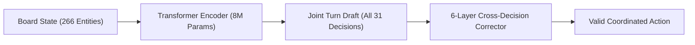
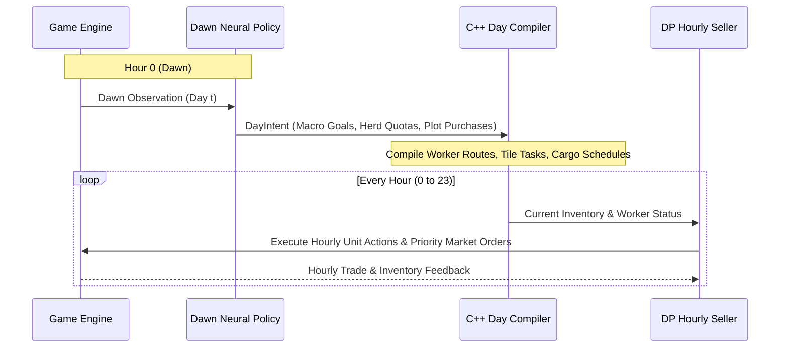

# Kaggriculture Master Post-Mortem: Gold Medal Solutions & The Four Winning Archetypes

The **Kaggriculture** simulation competition (720 turns, 30 game days, 2-player zero-sum shared market economy) challenged participants to control a complex farming enterprise: coordinate unit movements, crop watering and fertilizing, livestock care, storage capacity, and competitive market timing.

Across more than 10,200 competing teams, the gold medal bracket converged on a striking theoretical lesson: **pure reinforcement learning from scratch completely collapsed**, while **Behavioral Cloning (BC), executed-state imitation, hierarchical day compilers, and hybrid neural-combinatorial planners dominated the leaderboard**.

This handbook synthesizes the post-competition writeups and code releases from the confirmed top medalists:
- **1st Place**: Team M & M & P & Q (Alternating BC, synthetic heuristic teachers, and large-scale self-play PPO)
- **3rd Place**: Team DSM (`denden12`, `shimishige`, `masspeaks` — gen70 10.4M Transformer, C++/Rust engines, multi-stage post-processing)
- **4th Place**: Team Farmcore (Iaroslav Pudovkin — pure BC, executed-action training, one-pass transformer + corrector, zero RL/search)
- **6th Place**: Split-game BC/PPO (BC opening Days 1–11 + PPO mid/endgame Days 12–30, dual CPU/GPU leagues)
- **7th Place**: DECEM (Switched from heuristics in final 9 days; 8.2M entity Transformer with plain NumPy inference in 0.1s/turn)
- **19th Place**: Solo Gold (Multi-teacher distillation cloning 1st, 3rd, and 7th place teams)
- **26th Place**: Macro BC + Day Compiler (Hierarchical dawn `DayIntent` neural policy + C++ deterministic micro router & DP seller)
- **28th Place**: Team 吃白饭的大肥鱼 (Hybrid 10-day BC neural opening + 20-day Rust tile-project portfolio planner)

---

## 1. The Four Winning Solution Archetypes

The top 30 leaderboard segregated into four distinct, battle-tested architectural archetypes:

```mermaid
flowchart TD
    subgraph Archetype1["Archetype 1: BC → Critic Pre-Warm → PPO (1st, 3rd, 10th)"]
        A1_BC["Broad Replay BC"] --> A1_Val["Value Network Pre-Warm"]
        A1_Val --> A1_PPO["Paired Self-Play PPO + KL Anchor"]
        A1_PPO --> A1_Post["Multi-Stage Rule Post-Processing"]
    end

    subgraph Archetype2["Archetype 2: Pure BC on Executed State (4th, 7th, 19th, 27th)"]
        A2_Data["Kaggle API Replay Scraper"] --> A2_Clean["Filter to Executed State Changes (Drop Phantom Orders)"]
        A2_Clean --> A2_Cond["Conditioning: (Team, Recency, Win)"]
        A2_Cond --> A2_Net["Entity Transformer + Joint Corrector / NumPy"]
        A2_Net --> A2_Soup["Checkpoint Weight Soups"]
    end

    subgraph Archetype3["Archetype 3: Hierarchical Macro BC + Day Compiler (24th/26th)"]
        A3_Dawn["Dawn Neural Network: DayIntent"] --> A3_Comp["Deterministic C++ Day Compiler"]
        A3_Comp --> A3_DP["Hourly DP Seller vs Inferred Opponent Sales"]
    end

    subgraph Archetype4["Archetype 4: Hybrid Opening BC + Combinatorial Planner (28th)"]
        A4_BC["Neural BC Policy (Days 1–10)"] --> A4_Hand["History Replay Handover"]
        A4_Hand --> A4_Rust["C++/Rust Tile-Portfolio Planner (Days 11–30)"]
    end
```



| Dimension | Archetype 1: BC + PPO + Rules | Archetype 2: Pure Executed-Label BC | Archetype 3: Macro BC + Day Compiler | Archetype 4: Hybrid Opening + Planner |
| :--- | :--- | :--- | :--- | :--- |
| **Pioneering Teams** | 1st (MMPQ), 3rd (DSM), 10th | 4th (Farmcore), 7th (DECEM), 19th, 27th | 24th / 26th Gold | 28th Gold (吃白饭的大肥鱼) |
| **Compute Budget** | High (Multi-GPU / Cluster, 360M+ steps) | Low to Modest (5.5 A100-hrs to single Colab/5070) | Modest (Built in 5 days with LLM agent) | Modest (Trained on PPU, tested on CPU) |
| **Role of RL** | Large-scale self-play fine-tuning | Zero RL (RL found 10x less sample-efficient) | Zero RL | Zero RL |
| **Inference Mechanism** | Neural network + confidence repair / overrides | Neural network + joint corrector or 2 minimal rules | Dawn neural inference + deterministic C++ micro compiler | Days 1–10 Neural; Days 11–30 Combinatorial optimization |
| **Key Advantage** | Discovers emergent multi-agent coordination | Maximum training stability; zero RL reward noise | Eliminates mechanical pathing & collision failures | Exact mathematical crop portfolio & shed liquidation |

---

## 2. Core Breakthroughs & Competitive Lessons

### Breakthrough 1: Executed-State Labeling vs Player Orders (The Farmcore Discovery)
In complex game environments, top players frequently **over-order** (e.g. requesting multiple competing seed purchases or unit actions) and rely on the game engine to silently discard or reject invalid orders.
- **The Pathology**: Naive Behavioral Cloning trained directly on `steps[t+1].action` forces the neural policy to memorize illegal or phantom orders, teaching it to issue empty commands during inference.
- **The Fix (4th Place Farmcore)**: Decode the trajectory and train strictly on the **actual state changes applied by the official engine**. Retraining the exact same network on executed labels + a single feeding rule caused win rate against their previous best agent to surge from **3/24 to 23/24**.
- **Rule of Thumb**: Drop any replay where `encode → decode → engine` does not match the official game outcome to the exact coin.

### Breakthrough 2: Hierarchical Decomposition (Macro Intent at Dawn + Micro Day Compiler)
Managing 20 units across 720 individual turns creates a colossal action space ($31^{720}$) fraught with pathing deadlocks and coordination breakdowns.
- **26th Place Solution**: Decoupled strategic direction from labor execution.
  - **Dawn Neural Head (`DayIntent`)**: Evaluates board state once every 24 hours (at hour 0). Outputs only high-level macro targets: crops to buy/plant, plots of land to purchase, and group care/harvest quotas.
  - **Deterministic C++ Day Compiler**: Solves all micro logistics—worker route assignment, job dispatch, watering cadence, cargo hauling, shed space management, and market slot insertion.

### Breakthrough 3: Opponent Sales Inference & Dynamic Programming Liquidation
The opponent's private inventory and current turn actions are concealed, but market parameters and aggregate prices are public:
$$\Delta \text{Market Inventory} = \text{Our Sales} + \text{Opponent Sales} - \text{Town/Shop Consumption}$$
- By inverting this formula every hour, teams accurately computed:
$$\text{Opponent Sales}_t = \Delta \text{Market Inventory}_t + \text{Consumption}_t - \text{Our Sales}_t$$
- **Hourly DP Seller**: A dynamic programming routine planned sales across remaining hours, optimizing instantaneous price impact against the opponent's inferred production schedule and front-running their trades.

### Breakthrough 4: Market Slot Priority Mechanics
The official engine resolves simultaneous trades by matching orders **slot by slot in the order array**.
- If Player A and Player B both sell tomatoes at hour $t$, Player A's Order 0 is processed before Player B's Order 1.
- Listing higher-revenue goods in earlier order slots yielded **+\$4 to +\$10 per unit sold**, totaling **\$400–\$600 extra cash per match** in top-bracket games.

### Breakthrough 5: The Handover Protocol (Hybrid Opening + Endgame Planner)
- **28th Place (吃白饭的大肥鱼)** realized that Days 1–10 require flexible spatial intuition to adapt to random shop placements and weed configurations. Days 11–30 require strict combinatorial math to maximize revenue before turn 719.
- At hour 0 of Day 11, the agent transfers control from the neural network to a Rust/C++ planner.
- **State Handover**: The planner replays the entire 10-day history through its internal trackers to reconstitute tile ages, soil moisture, and worker queues before solving the tile project portfolio.

### Breakthrough 6: Conditioning on Team, Recency, and Win Outcome
- **7th Place (DECEM)** and **27th Place (monsaraida)** conditioned their entity Transformers on:
  1. `Team / Style ID`: One-hot vector of elite target teams (MMPQ, DSM, DECEM).
  2. `Recency`: Timestamp / submission date of the game (exponentially weighting newer replays as meta evolved).
  3. `Outcome`: Binary indicator of match win/loss.
- At inference time, agents were conditioned with: `Style = Team 1`, `Recency = Latest`, and `Outcome = Win`.

---

## 3. Deep-Dive: Solution Architectures

### A. Team DSM (3rd Place) — End-to-End Transformer + PPO + Post-Processing

#### 1. Input Tokenization (266 Tokens)
```text
Total Tokens: 266
├── 200 Board Tiles (10x10 farm grid for both players: crop type, growth age, wetness, weed status)
├── 20 Own Units (Farmer + up to 19 workers: position, held cargo, tool status)
├── 20 Opponent Units (Visible public positions and actions)
├── 16 Shops (Type, current commodity, price multipliers)
├── 9 Item / Commodity Summaries (Global supply, base prices, town demand)
└── 1 Global Token (Current day [0-29], hour [0-23], cash balance, remaining overage)
```
- Numeric continuous variables pass through a `Linear` layer; categorical features pass through categorical embeddings. Embeddings and projected continuous vectors are summed. No sequence positional embeddings are used.

#### 2. Network Backbone & Heads
- **Encoder**: 6-layer Transformer, $d=320$, 8 attention heads, Feed-Forward dimension 1024, Pre-LayerNorm.
- **Unit Head**: Concatenates unit token with the underlying tile token; outputs logits over 44 candidate actions masked by legal board state. A conditional 24-class head predicts movement/action quantities.
- **Market Head**: 2-layer autoregressive cross-attention decoder attending to all 266 encoder tokens. Outputs up to 10 market orders sequentially until `STOP` (23 order categories, 132 quantity buckets).
- **Parameters**: 10,441,973. Inference latency: ~0.112s on Kaggle CPU.

#### 3. Loss Formulation
$$\mathcal{L}_{\mathrm{BC}}(s) = -\sum_{u} \Big[\log \pi(c_u^* \mid s) + 0.5 \log \pi(q_u^* \mid s, c_u^*)\Big] - \sum_{j=1}^{L} \Big[w_j \log \pi(m_j^* \mid s, m_{<j}^*) + 0.5 \log \pi(r_j^* \mid s, m_{\le j}^*)\Big]$$
- Crucial nuance: $w_j = 20$ for `BUY_LAND` actions to counter extreme class imbalance (a typical match contains only 1–3 land purchases across 720 turns).

#### 4. Inference-Time Post-Processing Engine
DSM layered strict rule interventions over the raw model predictions:
1. `_land` rule: Between steps 240 and 709, if owning $<4$ plots and $(\text{Cash} + \text{Expected Sales}) \ge 4000$, inject `BUY_LAND`.
2. `MELON16` & Double-Cropping: On Day 16, buy melon seeds up to 3 units. On Days 16–19, replace `PLANT WHEAT` / `PLANT CARROT` with `PLANT MELON` (+456 coins/game gain on official engine).
3. `_pace` liquidation: From step 710 onward, sell remaining warehouse inventory divided by steps left. At hour 23, liquidate all barn contents before daily reset.

---

### B. Team Farmcore (4th Place) — One-Pass Transformer + Joint Corrector

Farmcore achieved 4th place using **zero self-play reinforcement learning and zero tree search**, relying purely on an elegant one-pass architecture and clean data engineering:



- **One-Pass Draft + Corrector**: Instead of autoregressive token generation (which is slow and introduces order bias), the encoder generates a simultaneous soft draft for all 20 units and 10 market orders. A 6-layer Transformer Corrector cross-attends across all draft decisions, allowing units to adjust to each other's planned locations and resource requirements in parallel.
- **Pretrain → Fine-Tune → Average (Model Soup)**:
  1. Pretrain on 8,583 replays from 67 top submissions.
  2. Fine-tune narrowly on a single top-1 team (563–766 replays).
  3. Average model weights across the top fine-tuned checkpoints (`Checkpoint Soup`).

---

### C. 26th Place Gold — Macro BC + Day Compiler



- **Output Interface (`DayIntent`)**:
  - `new_cow = 2`, `buy_land = 1`, `plant_tomato = 14`.
  - The network outputs high-level intentions. The deterministic C++ compiler handles all A* pathing, obstacle avoidance, tool equipping, watering cadence, and cargo return trips.
- **Benefits**: Completely eliminated suicidal worker behaviors, seed jamming, and pathing deadlocks that plagued unconstrained end-to-end neural policies.

---

### D. 28th Place Gold (吃白饭的大肥鱼) — Hybrid 10-Day BC + 20-Day Rust Planner

- **The Problem**: Pure heuristics struggled with opening versatility (shop lottery variations, initial quadrant layout). Pure neural policies struggled with endgame cash maximization and shed liquidation.
- **The Protocol**:
  - **Days 1–10**: Pure BC neural policy controls expansion, opening plot selection, and early animal acquisition.
  - **Day 11 Dawn Handover**: Rust combinatorial planner evaluates the farm.
  - **Tile Project Optimization**: Evaluates project portfolios $P$ by solving:
    $$J(P) = B(F(P)) - L(W(P)) - C(P)$$
    where $B(F(P))$ is product flow market revenue, $L(W(P))$ is labor wage cost, and $C(P)$ is capital expenditure.
  - **Terminal Liquidation Window**: Strict liquidation trigger at **Day 29, Hour 22** (turn 718). All remaining crops are converted to cash; no item is left in unit backpacks or storage.

---

## 4. Evaluation Engineering: C++ & Rust Simulation Engines

Top teams abandoned the official Python interpreter (`kaggle-environments`) for local training and league validation:

| Engine | Technology | Throughput | Use Case | Fidelity Requirements |
| :--- | :--- | :--- | :--- | :--- |
| **Official Python** | `kaggle-environments` | ~0.02 games/s | Final verification & ground truth | Native Python baseline |
| **DSM C++ (`kagsim`)** | C++17 / PyBind11 | 256 games/s (12,000× speedup) | PPO rollouts & FastEval | CPython MT19937 RNG parity |
| **DSM Rust Engine** | Rust / Rayon | 29,800 games/s (8 threads) | Round-robin league tournaments | MT19937 + dict insertion order parity |
| **6th Place GPU Engine** | LibTorch / CUDA | Batches of 128 parallel games | PPO rollouts on GPU cluster | Parallel tensor mechanics |

### Critical Parity Traps
1. **RNG Parity**: The official interpreter uses Python's standard `random.Random` (Mersenne Twister MT19937). Fast engines had to implement exact CPython-compatible MT19937 state generation.
2. **Dict Insertion Order**: When the shed overflows (capacity 100), items are preserved according to Python dict insertion order. Fast engines that used hash maps without insertion preservation diverged from official match outcomes.
3. **Paired-Seed Evaluation Gate**:
   - Never evaluate on random unpaired games.
   - Run candidate models on **768 to 1,536 paired games** (swapping Seat 0 and Seat 1 on identical seeds).
   - Gate criterion: Candidate must achieve win rate $\ge 0.52$ ($z > 2.0$) against incumbent champion across paired games.

---

## 5. What Failed: Anti-Patterns & Negative Results

The following intuitive ideas were tested extensively by gold medalists and decisively failed:

| Failed Hypothesis | Experimental Result | Why It Failed |
| :--- | :--- | :--- |
| **From-Scratch PPO (No BC)** | Complete training collapse; win rate 0.00 | Horizon is 720 steps with 31 decisions/step. Sparse terminal win/loss cannot bridge credit assignment to early actions. |
| **Optimizing on Held-Out BC Loss** | Lower BC loss produced zero gain or weaker agents | Cross-entropy loss measures token matching on average moves (dominated by `PASS` / movement), not strategic game-winning inflection points. |
| **Scaling Model Size to 27M–66M** | 27.8M model showed identical win rate (+604 ± 1400 coins) | 10M parameters was sufficient to saturate policy capacity; bottleneck was data diversity and game coordination. |
| **Mixed Multi-Teacher Embeddings** | Weaker than fine-tuning on a single elite teacher | Blending incompatible high-level play styles (e.g. melon rushing vs multi-animal farming) created indecisive hybrid policies. |
| **Action Sampling at Play Time** | Degraded performance across all benchmarks | Temperature sampling introduced fatal action errors; deterministic greedy argmax inference won consistently. |
| **Feeding Unit Previous Action** | Clone learned to copy itself, losing -\$25k | Created pathological loops where units repeatedly executed obsolete commands. |

---

## 6. Comprehensive Summary Table of Winning Approaches

| Rank | Team / Author | Model Family | Key Innovation | Compute / Framework |
| :---: | :--- | :--- | :--- | :--- |
| 🥇 **1st** | M & M & P & Q | 10M Transformer | Alternating BC & Self-Play PPO; synthetic heuristic teachers; paired zero-sum reward | Multi-host JAX cluster |
| 🥉 **3rd** | DSM | 10.4M Transformer (gen70) | Replay BC on MMPQ; value pre-warm PPO; Rust engine (29.8k g/s); post-processing rules | JAX / C++ `kagsim` / Rust |
| 🏅 **4th** | Farmcore | 8M Transformer | Pure BC on executed state changes; 1-pass draft + 6-layer joint corrector; checkpoint soup | 5.5 A100-hours / PyTorch |
| 🏅 **6th** | 6th Place | Split Transformer | Split-game policy: BC Days 1–11 + PPO Days 12–30; dual CPU/GPU evaluation leagues | Dual CPU/GPU League |
| 🏅 **7th** | DECEM | 8.2M Entity Transformer | Switched to BC in final 9 days; conditioned on (Team, Version, Win); pure NumPy inference (0.1s) | Single GPU + NumPy CPU |
| 🏅 **10th** | 10th Place | Transformer | Consumer hardware proof: BC + PPO trained end-to-end on a single RTX 5090 | 1× RTX 5090 |
| 🏅 **19th** | Solo Gold | Entity Transformer | Multi-teacher distillation cloning 1st, 3rd, and 7th place teams with outcome conditioning | Single GPU |
| 🏅 **26th** | Macro BC | Dawn Transformer + C++ | Hierarchical dawn `DayIntent` + C++ Day Compiler + hourly DP seller vs inferred opponent sales | 5-day agent build / PyTorch |
| 🏅 **28th** | 吃白饭的大肥鱼 | Hybrid BC + Rust | 10-day BC neural opening + 20-day Rust tile-project portfolio planner; Day 29 H22 liquidation | PPU / Rust |
