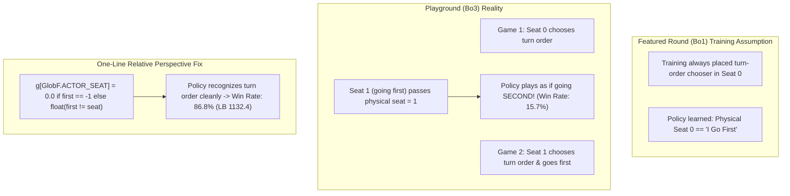

# Pokémon TCG AI Battle Challenge Playground: Post-Mortem & Key Engineering Lessons

The **Pokémon Company — PTCG AI Battle Challenge Playground** (`the-pokemon-company-ptcg-ai-battle-challenge-playground`) is a reinforcement learning and game simulation competition hosted by The Pokémon Company. Agents play the **Pokémon Trading Card Game (PTCG)** in a Best-of-Three (Bo3) match format inside Kaggle's `cabt` simulation environment.

This post-mortem synthesizes the core game contract, top ladder architectures (notably Dipam Chakraborty's Token-Transformer from the Featured round and Akmal Xodarev's Playground ladder breakthrough), deck meta dynamics, the legendary **"Seat Bug"** forensic breakdown (**LB 1132.4, Top 3**), and zero-forfeit runtime guardrails.

---

## 1. Executive Summary & Core Results

| Dimension | Specification / Metric |
| :--- | :--- |
| **Game Format** | Best-of-Three (Bo3) in a single Kaggle episode (`cabt` environment) |
| **Action Space** | Dynamic discrete option selection from `obs.select.option` (length between `minCount` and `maxCount`) |
| **Clock Budget** | 600 seconds shared across all 3 games in the match; panic threshold at 30s |
| **Top Policy Architecture** | Dipam Chakraborty's Token-Transformer (3rd in Featured Round) + Akmal Xodarev's One-Line Seat Fix |
| **Public Ladder Result** | **LB 1132.4** (3rd of 230 teams) |
| **The Game-Changing Fix** | Replacing physical seat index with relative turn-order indicator: win rate in `[Seat 1, Going First]` jumped from **15.7% (68/431) to 86.8% (304/350)** (**+168 Elo**) |
| **Dominant Deck Meta** | Hydrapple ex / Teal Mask Ogerpon ex (66% of 1000+ rated seats) & Alakazam / Kadabra (65–68% win rate) |

---

## 2. Environment Architecture & The Bo3 Contract

### A. The Kaggle `cabt` Protocol
The engine (`cg/`) interacts with `main.py:agent(obs_dict)` via JSON payloads:
1. **Initial Step (`obs.select is None`)**: The engine queries the agent for its 60-card deck list (valid card IDs from `deck.csv`).
2. **Decision Step (`obs.select` populated)**:
   - `obs.select.option`: Legal options available for the current choice context.
   - `obs.select.minCount` / `obs.select.maxCount`: Bounds on how many indices may be returned.
   - Return format: A deduplicated list of 0-based option indices.

### B. Best-of-Three (Bo3) Round-Boundary Reset
Unlike the earlier Featured round (Bo1), Playground runs up to three sequential games inside one persistent episode. A new game starts whenever `obs["current"]["round"]` changes, requiring immediate resets of per-game trackers and rejection caches:

```python
rd = (obs_dict.get("current") or {}).get("round")
if rd != GAME["round"]:
    if GAME["round"] is not None:
        SA.tracker = InfoTracker(SA.deck)
        SA.forced_run = 0
        LAST["sig"], LAST["logs"] = None, None
        REJ["sig"], REJ["tried"] = None, []
    GAME["round"] = rd
```

---

## 3. The "Seat Bug" Forensic Post-Mortem

The single most impactful discovery of the Playground round was uncovered by Akmal Xodarev (Busya PRIME), explaining why strong Featured-round checkpoints collapsed in Bo3 matches.



### Root Cause & Quantified Impact
- In Featured (Bo1) self-play training, Seat 0 always held the opening turn-order decision, so the transformer equated physical `GlobF.ACTOR_SEAT = 0.0` with *"going first"* and `1.0` with *"going second"*.
- In Bo3 Game 2, Seat 1 holds the opening choice and goes first—passing `ACTOR_SEAT = 1.0` confused the pretrained model into skipping aggressive Turn-1 energy/setup plays.
- **Paired Local Validation (vs. 4 strong public bots)**:
  - `[Seat 1, Going First]` before fix: **68 / 431 (15.7%)**
  - `[Seat 1, Going First]` after fix: **304 / 350 (86.8%)**
  - Match points jumped from **0.744 → 0.940**, lifting the exact same checkpoint from **942.8 to 1110.4–1132.4 (+168 Elo)**.

```python
# In encoder feature construction:
g[GlobF.I_AM_FIRST] = float(first == seat)
# Encode relative turn-order seat rather than raw physical seat:
g[GlobF.ACTOR_SEAT] = 0.0 if first == -1 else float(first != seat)
```

---

## 4. Meta-Game & Deck Strategy Analysis

Ladder replay analytics (Darren Sheehan) highlighted two decisive meta drivers:

1. **Going-First Tempo Advantage (+18 to +23 Percentage Points)**:
   - Attaching energy and evolving first delivers a massive tempo edge across Dragapult mirrors, Dragapult vs. Lucario, and Clefairy/Ursaluna matchups.
   - **Deterministic Override**: Whenever prompted for turn order (`sel.get("context") == 41`), always pick going first (`type == 1`):
     ```python
     if sel.get("context") == 41:  # IS_FIRST choice
         idx = [i for i, o in enumerate(sel.get("option") or []) if o.get("type") == 1]
         if idx:
             return [idx[0]]
     ```
2. **Deck Archetype Hierarchy**:
   - **Hydrapple ex / Teal Mask Ogerpon ex**: ~66% of 1000+ rated seats; consistent Grass Energy acceleration + scaling damage + high HP survivability.
   - **Alakazam / Kadabra**: Highest broad-field win rate (~65–68%), dominating Clefairy/Ursaluna lists (~90% WR).
   - **Mega Abomasnow ex / Kyogre**: High-bulk Water spread countering fire/fighting decks.

---

## 5. Model Architecture & Zero-Retrain Card Vocabulary Expansion

### A. Token-Transformer Policy (`TransformerPolicy`)
- **Entities**: Hand cards, Active Pokémon, 5 Bench slots, attached Energy, opponent visible zones, and legal Option tokens, each tagged with a learned group embedding.
- **Backbone**: 4 Transformer blocks, `d_model = 256`, `8` attention heads.
- **Heads**: Dot-product cross-attention Action Scorer over legal option tokens + scalar Value Head estimating match win probability.

### B. Extending the Card Pool (1,267 → 1,431 Cards)
The Playground environment expanded from 1,267 cards / 1,556 attacks (Featured) to **1,431 cards / 1,755 attacks**. Rather than discarding Featured weights, top submissions extended the embedding tables (`embed_pca.npz`) via **linear PCA projections of engine card stats** into the pretrained latent space, mapping newly introduced cards onto semantically adjacent clusters without index crashes or full retraining.

---

## 6. Runtime Robustness & Debugging Pitfalls

In Kaggle's simulation runtime, a single unhandled exception or illegal-move loop causes an immediate forfeit. Four engineering safeguards proved essential:

1. **Rejection vs. Re-Presentation Guard**: Track `obs["logs"]` (event delta since the last *accepted* action). If an identical option signature reappears with identical logs, the previous move was rejected—step systematically through alternate legal options (`_recover(sel)`) instead of looping until clock-out.
2. **Shared-Clock Panic Valve**: Because 600s is shared across all 3 games of a Bo3 match, monitor `remainingOverageTime` and switch to instant legal fallback below `30s` to prevent late-match timeouts.
3. **The Silent `try...except` + Encoding Trap**: Wrapping agent inference in a production `try...except` fallback can hide deterministic crashes during local testing (for example, omitting `encoding="utf-8"` when reading card JSON triggers `UnicodeDecodeError` on Windows `cp1252`, silently degrading a neural policy to 100% random legal moves). Always open text/JSON files with `encoding="utf-8"` and **disable catch-all fallbacks in unit/arena tests**.
4. **Statistical Rigor for RL Fine-Tuning**: When fine-tuning a pretrained card-game Transformer via KL-anchored self-play PPO, always validate promotions across large paired-seed seat-swapped gauntlets (small 10-match series carry wide Wilson confidence intervals such as `[0.31, 0.83]` and cannot reliably distinguish small Elo edges from variance).
