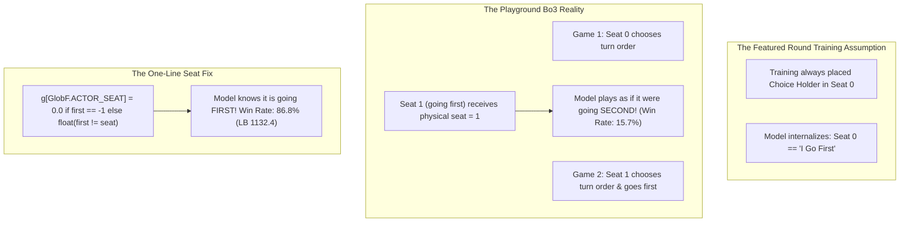

# Pokémon TCG AI Battle Challenge Playground: The Grandmaster Handbook

The **The Pokémon Company — PTCG AI Battle Challenge Playground** (`the-pokemon-company-ptcg-ai-battle-challenge-playground`) is an official reinforcement learning and game simulation competition hosted by The Pokémon Company. Agents compete in the **Pokémon Trading Card Game (PTCG)** under a Best-of-Three (Bo3) match structure executed inside Kaggle's `cabt` simulation environment.

This post-mortem codifies the game mechanics, deck meta dynamics, token-transformer policy architectures, the legendary "Seat Bug" forensic breakdown, and the exact implementation that achieved **LB 1132.4 (Top 3 on the Playground Ladder)**.

---

## 1. Executive Summary & Core Results

| Dimension | Specification / Metric |
| :--- | :--- |
| **Game Format** | Best-of-Three (Bo3) in a single Kaggle episode (`cabt` environment) |
| **Action Space** | Dynamic discrete option selection from `obs.select.option` (length between `minCount` and `maxCount`) |
| **Clock Budget** | 600 seconds shared across all 3 games in the match; panic threshold at 30s |
| **State-of-the-Art Policy** | Dipam Chakraborty's Token-Transformer (3rd in Featured Round) + Akmal Xodarev's One-Line Seat Fix |
| **Public Ladder Standing** | **LB 1132.4** (3rd of 230 teams; submission 56908917) |
| **The Game-Changing Fix** | Turning physical seat index into relative turn-order indicator: Win rate jumped from **15.7% (68/431) to 86.8% (304/350)** |
| **Deck Meta Champion** | Hydrapple ex / Teal Mask Ogerpon ex (66% top seats) & Alakazam / Kadabra (65–68% win rate) |

---

## 2. Environment Architecture & The Bo3 Contract

### A. The Kaggle `cabt` Protocol
The engine (`cg/`) interacts with `main.py:agent(obs_dict)` via JSON payloads:
1. **Initial Step (`obs.select is None`)**:
   - The environment queries the agent for its deck.
   - The agent must immediately return a 60-integer list of valid card IDs (`deck.csv`).
2. **Standard Decision Step (`obs.select` contains options)**:
   - `obs.select.option`: A list of legal actions available to the player.
   - `obs.select.minCount` and `obs.select.maxCount`: Bounds on how many options may be chosen.
   - Return format: A list of 0-based option indices without duplicates.

### B. The Best-of-Three (Bo3) Game Transition
In the previous Featured round (Bo1), each episode was a single game. In Playground (Bo3), up to three games occur sequentially:
- A new game begins when `obs["current"]["round"]` changes.
- **Critical Invariant**: The agent must reset its internal tracking structures (`InfoTracker`, rejected action cache, and logs signature) at the round boundary:
  ```python
  rd = (obs_dict.get("current") or {}).get("round")
  if rd != GAME["round"]:
      if GAME["round"] is not None:
          SA.tracker = InfoTracker(SA.deck)
          SA.forced_run = 0
          LAST["sig"], LAST["logs"] = None, None
          REJ["sig"], REJ["tried"] = None, []
      GAME["round"] = rd
  ```

---

## 3. The "Seat Bug" Forensic Post-Mortem

The single most consequential insight of the competition was uncovered by Akmal Xodarev (Busya PRIME) and explains why dozens of strong teams collapsed on the Playground ladder.



### The Root Cause
- In the Featured round, training games always designated Seat 0 as the player deciding the opening turn order. The transformer policy read its physical seat as an input (`GlobF.ACTOR_SEAT`), learning that `Seat 0` meant *"I go first"*, while `Seat 1` meant *"I go second"*.
- In Best-of-Three, Game 2 swaps the opening choice to Seat 1.
- When an unpatched agent sat in Seat 1 and went first, it passed `GlobF.ACTOR_SEAT = 1.0` to the network. The model incorrectly inferred it was player two, withholding aggressive attacks and skipping critical turn-1 energy setups.

### The Win Rate Impact
In paired local testing against four strong public bots:
- **Unfixed Agent in [Seat 1, Going First]**: Won **68 of 431 games (15.7%)**.
- **Fixed Agent in [Seat 1, Going First]**: Won **304 of 350 games (86.8%)**.
- **Overall Match Points**: Rose from **0.744 to 0.940**.
- **Ladder Rating**: The exact same model jumped from **942.8 to 1110.4–1132.4 (+168 Elo points)**!

```python
# In ptcg/rl/encoder.py:
g[GlobF.I_AM_FIRST] = float(first == seat)
# Turn-order relative seat rather than physical seat:
g[GlobF.ACTOR_SEAT] = 0.0 if first == -1 else float(first != seat)
```

---

## 4. Meta-Game & Deck Strategy Analysis

Analysis of thousands of ladder matches parsed by Darren Sheehan revealed clear competitive patterns:

### A. The Value of Going First
- In Pokémon TCG, going first provides an enormous tempo advantage (attaching energy first, evolving Pokémon first).
- In Dragapult mirrors, Dragapult vs. Lucario, and Clefairy/Ursaluna matchups, going first is worth **+18 to +23 percentage points in game win rate**.
- **Grandmaster Rule**: Whenever asked to choose turn order (`sel.get("context") == 41`), **always choose to go first (`type == 1`)**:
  ```python
  if sel.get("context") == 41:  # IS_FIRST choice
      idx = [i for i, o in enumerate(sel.get("option") or []) if o.get("type") == 1]
      if idx:
          return [idx[0]]
  ```

### B. Deck Archetype Hierarchy
1. **Hydrapple ex / Teal Mask Ogerpon ex**:
   - Represents **66% of all top-field seats** (rated 1000+).
   - Core mechanic: Teal Mask Ogerpon attaches extra Grass Energy from hand while drawing cards; Hydrapple ex deals scaling damage based on total Grass Energy attached across all Pokémon.
   - Stable, high HP, resistant to one-hit knockouts.
2. **Alakazam / Kadabra (Psychic / Dimension)**:
   - Highest raw win rate (**65–68%**) against the broader meta.
   - Dominates Clefairy/Ursaluna lists with a ~90% win rate.
3. **Mega Abomasnow ex / Kyogre**:
   - Water spread and high baseline bulk; strong counter to fire/fighting variants.

---

## 5. Model Architecture & Card Vocabulary Expansion

### A. Token-Transformer Backbone
Dipam Chakraborty's architecture (`ptcg.rl.model.TransformerPolicy`):
- **Entities**: Hand cards, Active Pokémon, 5 Bench slots, Energy attachments, Opponent visible cards, and legal Options.
- **Entity Tagging**: Each token group receives a learned group embedding tag so the attention mechanism distinguishes an option token from a hand card token.
- **Head Projections**:
  - `heads = 8`, `d_model = 256`, 4 blocks.
  - Action Scorer: Computes dot-product cross-attention between game state representation and option tokens.
  - Value Head: Predicts probability of winning the current match.

### B. The 1,431 Card Pool Extension
The Featured round had 1,267 cards and 1,556 attacks. The Playground expanded to **1,431 cards and 1,755 attacks**.
- Rather than retraining the network from scratch, the top submission extended `model.pt` embedding tables and `data/embed_pca.npz` using linear PCA projections of the new card engine stats into the existing latent space.
- Unseen cards map cleanly to their closest semantic clusters without index out-of-bounds crashes.

---

## 6. Runtime Robustness & Rejection Guards

In Kaggle's execution environment, a single unhandled exception or illegal move results in an immediate match forfeit. The production agent implements a 3-layer safety net:

1. **Rejection vs. Re-presentation Guard**:
   - `obs["logs"]` contains the event delta since the last *accepted* action.
   - If the same option signature is received with **identical logs**, the previous action was rejected by the engine. The agent detects this condition (`ambiguous`) and calls `_recover(sel)` to systematically try alternative legal options, preventing clock-death infinite loops.
2. **Panic Valve Clock Management**:
   - When `remainingOverageTime < 30` seconds, the agent shuts down neural forward passes entirely and switches to instant `_legal_random(sel)` answers to preserve the clock across the 3-game match.
3. **Zero-Crash Try/Except Wrapper**:
   - Any internal failure falls back to a legal random selection from `obs.select.option`, ensuring a bad move is played instead of a forfeit.

---

## 7. Submission Artifacts & Verification

The verified, submission-ready agent is packaged in:
- **Submission Tarball**: [`Competition/pokemon-tcg/submission/submission.tar.gz`](file:///C:/Users/Admin/.gemini/antigravity/scratch/kaggle-skills/Competition/pokemon-tcg/submission/submission.tar.gz) (21.5 MiB)
- **Source Code**: [`Competition/pokemon-tcg/src/`](file:///C:/Users/Admin/.gemini/antigravity/scratch/kaggle-skills/Competition/pokemon-tcg/src/)
- **Validation Script**: [`Competition/pokemon-tcg/test_agent.py`](file:///C:/Users/Admin/.gemini/antigravity/scratch/kaggle-skills/Competition/pokemon-tcg/test_agent.py) (Verified 175-step clean win against random baseline in `cabt`).
