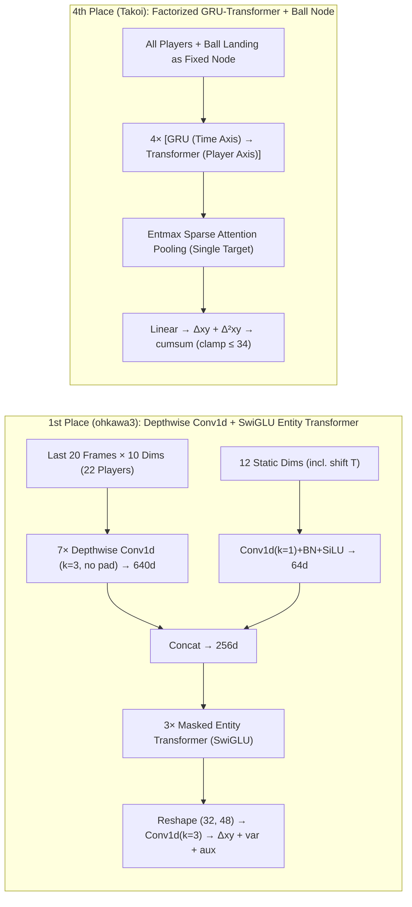

# NFL Big Data Bowl 2026 — Prediction: Top Solutions & Post-Mortem

> **Competition**: [NFL Big Data Bowl 2026 - Prediction](https://www.kaggle.com/competitions/nfl-big-data-bowl-2026-prediction) (Sep 2025 – Jan 7, 2026 | 1,899 Teams, 772 Final Cleaned LB | \$50,000 Prize Pool)  
> **Task**: Multi-Agent 10 Hz Spatiotemporal Trajectory Forecasting — predict post-throw `(x, y)` coordinates while the football is in flight  
> **Evaluation Metric**: Joint 2D Coordinate RMSE: $\text{RMSE} = \sqrt{\frac{1}{2N}\sum_{i=1}^N \left[(x_i - \hat{x}_i)^2 + (y_i - \hat{y}_i)^2\right]}$  
> **Dataset**: 18 weeks of 2023 NFL tracking (~14,108 valid plays, 10 Hz pre-throw kinematics + `ball_land_x/y`, `num_frames_output`) | Live Rerun Private Test: Final 5 weeks of 2025–2026 NFL regular season (~60k rows via single-play `kaggle_evaluation` API, `<= 9h`)

---

## Official Top Leaderboard Standings & Solution Index

In a live prospective forecasting competition (evaluated on real NFL games played *after* submission freeze), **factorized spatiotemporal neural networks predicting displacements (`Δx, Δy`) with `GaussianNLLLoss` / `TemporalHuber` and sliding-window trajectory augmentation** decisively beat heavy tabular feature engineering and GBDTs:

| Private Rank | Team / Competitor | Private LB (RMSE ↓) | Public LB / CV | Core Winning Paradigm | Writeup / Code |
| :---: | :--- | :---: | :---: | :--- | :--- |
| 🥇 **#1** | **`ohkawa3`** (`chack3`) | **0.46340** | Pub #3 · CV `~0.470–0.473` | **Depthwise Conv1d (time) + 3-layer SwiGLU Transformer (22 players) + Conv1d decoder**; **early-frame shift (`T=0..20`) + uniform 360° rotation** + **`GaussianNLLLoss`** (xy + vel + acc) + RAdam/EMA (`0.9995`), 100+ model avg (no external data) | [Writeup](https://www.kaggle.com/competitions/nfl-big-data-bowl-2026-prediction/writeups/public-3rd-solution) · [Train](https://www.kaggle.com/code/chack3/nfl2026-1st-place-train) · [Infer](https://www.kaggle.com/code/chack3/nfl2026-1st-place-inference) |
| 🥈 **#2** | **`足球小将`** (`yuanzhe zhou`) | **0.46475** | Holdout last 5 wks | Minimal raw inputs + **RNN encoder + Spatio-Temporal encoder** predicting frame-to-frame `Δx, Δy` + `cumsum`; `TemporalHuber(0.5, exp(-0.03t))`; **Muon optimizer + EMA**; joint 2021+2023 training | [Writeup](https://www.kaggle.com/competitions/nfl-big-data-bowl-2026-prediction/writeups/2nd-place-solution) |
| 🥉 **#3** | **`NoFreeLunch`** (`heng`, `yanqiangmiffy`, `灵曜`, `sayoulala`) | **0.46575** | Pub `0.456` · CV `~0.469` | **Wide-shallow Dual-Path ST-Transformer** (`d=384, L=2, dropout=0`) pre-trained & fine-tuned on 2018+2023 NFL; **3 self-supervised temporal auxiliary losses** (`+0.033` LB); player dropout/slot shuffle + head crop; `0.5/0.25/0.25` TTA | [Writeup](https://www.kaggle.com/competitions/nfl-big-data-bowl-2026-prediction/writeups/3rd-place-solution) |
| 🏅 **#4** | **`Takoi`** | **0.47627** | Pub #5 | **Single-target prediction** with **Ball Landing Spot as a distinct Graph/Attention Node**; 4× `[GRU (time) → Transformer (player)]` + **Entmax pooling**; `cumsum` Δx/Δy clamped at 34 frames; `TemporalHuber + GaussianNLL` blend + 4× flip TTA | [Writeup](https://www.kaggle.com/competitions/nfl-big-data-bowl-2026-prediction/discussion/651814) |
| 🏅 **#5** | **`T0m`** (`tomyanabe`) | **0.47687** | — | Frame-to-frame `Δx, Δy` with **RoPE future-frame index encoding**; `HuberLoss` + **Muon optimizer** + EMA (`0.995`); 2-stage training with 2023 all-player imputation & pseudo-labeling of non-scored players | [Writeup](https://www.kaggle.com/competitions/nfl-big-data-bowl-2026-prediction/writeups/5th-place-solution) |
| 🥈 **#19** | **`epsilon`** | **0.50408** | Pub `0.504` | Single-agent ST-Transformer (collision/`1/d`/FOV spatial biases) + **TXP-CNN decoder** + `GaussianNLL` + passer-centric origin + pre-pass TTT (`+0.001`) | [Writeup](https://www.kaggle.com/competitions/nfl-big-data-bowl-2026-prediction/writeups/th-place-solution) |
| 🥈 **#23** | **`WOOSUNG YOON`** | **0.50912** | — | GRU + Gated Cross-Attention + **Coarse-to-Fine hierarchical decoder** (`T/8→T/4→T/2→T`) + **Cauchy loss** + GA ensemble | [Writeup](https://www.kaggle.com/competitions/nfl-big-data-bowl-2026-prediction/writeups/gru-solution) |
| 🥈 **#24** | **`Yannan Chen`** | **0.50920** | Pub #23 | Play-level ST-Transformer with edge biases (`sameteam, dist, closing_speed`) + **virtual pre/post-pass cut windows** (`+200k` samples, weight `0.5`) | [Writeup](https://www.kaggle.com/competitions/nfl-big-data-bowl-2026-prediction/writeups/public-23rd-solution-data-augmentation) |
| 🥈 **#33** | **`活了活了`** (`hsiaosuan` et al.) | **0.51426** | Pub `0.519` | `STTRE` 3-branch Transformer + GNN + Bi-GRU; **Chiral Y-flip symmetry**; **Polar Vector Ensemble** (averaging speed & unit direction separately) + time-decaying GRU weight | [Writeup](https://www.kaggle.com/competitions/nfl-big-data-bowl-2026-prediction/writeups/relembedding-architecture-and-chiral-augmentation) |

*(Note: Ranks 6–13 did not publish public writeups; Silver medal writeups #19, #23, #24, #33 are included for distinct architectural and ensembling innovations.)*

---

## 1. Competition DNA & Spatiotemporal Problem Structure

- **Physical Setup**: Each play supplies **10 Hz** pre-throw tracking for up to 22 players (`x ∈ [0,120]`, `y ∈ [0,53.3]`, speed `s`, acceleration `a`, orientation `o`, motion direction `dir`, `player_role`, `player_side`, `play_direction`) plus the known future ball landing coordinates `(ball_land_x, ball_land_y)` and target flight length `num_frames_output`.
- **Zero Live Post-Throw Observations**: Once the quarterback releases the ball, **no live tracking frames are provided**—models forecast the entire post-throw trajectory open-loop for all players flagged `player_to_predict == True`.
- **Real Prospective Evaluation**: Private LB ran on the final 5 weeks of the *future* 2025–2026 season (Dec 2025 – Jan 2026), making **generalization across unseen games/weeks** and **low-variance physics inductive bias** far more important than memorizing 2023 plays.
- **Data Hygiene (1st Place)**: Dropping just **5 corrupted/outlier plays** (`2` abnormally long plays `2023091100_3167`, `2023122100_1450`; `3` plays missing a passer `2023091001_3216`, `2023112606_4180`, `2023121009_3594`) stabilized gradient norms cleanly.

---

## 2. Target Formulation & Loss Functions (Universal Consensus)

### 2.1 Displacement & Cumulative Velocity Targets Beat Raw Coordinates
Every single Top-5 solution abandoned raw `(x, y)` regression and polar `(speed, dir)` prediction (which 2nd place verified was inferior):
- **Offset from Last Observed Frame** (1st): Predict $(\Delta x_t, \Delta y_t)$ relative to final pre-throw position $(x_0, y_0)$ and add back $(x_0, y_0)$.
- **Frame-to-Frame Velocity Delta + `cumsum`** (2nd, 4th, 5th): Predict step deltas $(\delta x_t, \delta y_t)$ per 0.1s frame and reconstruct positions via cumulative sum, naturally enforcing smooth physical continuity. 4th place also predicted 2nd-order acceleration deltas and **clamped horizons >34 frames** (repeating frame 34) because ultra-rare long throws destabilized tail errors.

### 2.2 `GaussianNLLLoss` vs. `TemporalHuber` (And Combining Both!)
| Loss Family | Exact Formulation | Teams | Why It Works on Spatiotemporal Forecasting |
| :--- | :--- | :---: | :--- |
| **Heteroscedastic `GaussianNLLLoss`** | Predict $(\hat{\mu}_x, \hat{\mu}_y, \hat{\sigma}_x^2, \hat{\sigma}_y^2)$ with $\hat{\sigma}^2 = \text{softplus}(\cdot) + 10^{-3}$; apply to positions **and** 1st/2nd finite differences (velocity & acceleration) | **#1**, #4, #19 | Automatically downweights irreducible late-horizon uncertainty (e.g. contested deep routes) so unpredictable outliers don't hijack gradients; beat `SmoothL1` by **~0.010 RMSE** in 1st place ablation |
| **Decayed `TemporalHuber`** | Huber (`delta=0.5`) weighted by $\exp(-0.03 \cdot t)$ across horizon $t$ + 1st/2nd-order smoothness terms (3rd) | **#2**, **#3**, #4, #5, #24 | Resists outlier collisions/cutbacks while focusing gradient precision on early kinematic trajectory anchoring (note from #24: weight numerator cleanly without double-squaring mask weights) |
| **Multi-Loss Ensemble** | Train parallel models with `GaussianNLL` and `TemporalHuber` and average coordinates | **#4** | Combines variance-calibrated mean estimation with robust L1-tail behavior |

---

## 3. Symmetries, Coordinate Canonicalization & Data Scaling

With only ~14,108 training plays in 2023, scaling effective supervision without distorting physics was the #1 driver separating Gold from Silver:

### 3.1 Exact Geometric Symmetries (Augmentation & TTA)
1. **Direction Canonicalization (`unify_left`)**: Rotate all `play_direction == "left"` plays 180° (1st, 19th, 33rd) so every offense attacks in one canonical direction, halving the coordinate space.
2. **Chiral (Vertical Y-Flip) & H+V Flip Symmetry**: Mirroring across the field midline (`y' = 53.3 - y`, negating `vy, ay`, reflecting orientation/direction angles) is an **exact physical invariance** used both during training and as `2×–4×` TTA (1st, 2nd, 3rd, 4th, 33rd).
3. **Uniform 360° Play Rotation (1st Place Surprise Breakthrough)**: Rotating the *entire play* (all players + ball landing spot + headings) by a **uniform random angle in $[0^\circ, 360^\circ)$** around the mean player position with `p=0.5` **outperformed small Gaussian $\sigma=5^\circ$ rotations** — breaking field-axis overfitting completely!

### 3.2 Early-Frame Shift & Self-Supervised Temporal Windowing
The highest-leverage data augmentation across non-external-data winners was **shifting the forecast origin backward into the pre-throw history**:
- **1st Place (`Early-Frame Prediction`, `T ∈ [0, 20]`)**: Randomly starts forecasting up to `20` frames earlier, predicting `(T earlier pre-throw frames) + (original post-throw frames)` for **all players** while passing `T` as a static conditioning feature (`T=0` at inference). Alone improved CV `0.475 → 0.473` (and community ablations measured `0.010–0.036` RMSE impact!).
- **3rd Place (`3 Self-Supervised Temporal Auxiliary Losses`, `+0.033` LB)**:
  - `1.0 × inter-frame` input-to-later-input displacement (`+0.020` LB),
  - `0.1 × end-point` prediction from every input frame to the final target frame (`+0.010` LB),
  - `0.1 × full-correspondence` across all `(input_t, output_t')` pairs (`+0.003` LB),
  plus random input head-cropping (`2–6` frames dropped), random player dropout (`1..5`), and within-side slot shuffling.
- **24th Place**: Virtual pre- & post-pass sliding-window cuts added `+200k` training windows (loss weight `0.5`).

### 3.3 Historical Data Scaling & Pseudo-Labeling (2nd, 3rd, 5th)
- **External NFL Seasons (2018 & 2021)**: 2nd place trained jointly on `2021 + 2023` (joint beat pretrain-then-finetune); 3rd place saw LB jump from `~0.480–0.485` to **`0.456`** Public (`0.46575` Private) by adding 2018 tracking (`ball_snap → pass_forward → pass_arrived`, reconstructing `ball_land` from `team == 'football'`) via 2-stage bridge pretraining + fine-tuning.
- **All-Player Pseudo-Labeling (5th Place)**: Stage 1 trained on scored players (`player_to_predict == True`); Stage 2 generated pseudo-labels for all non-scored players so the multi-agent encoder received dense play-wide supervision.

---

## 4. Factorized Spatiotemporal Neural Architectures

Heavy tabular feature engineering and GBDTs were completely eclipsed by **lean-input neural sequence-interaction models** separating the **time axis** and **entity (player) axis**:

### Key Architectural Discoveries Across Top 5 + Silver
1. **Depthwise Conv1d over Regular Conv1d (1st Place)**: Encoding the 10 dynamic channels independently with **7 depthwise `Conv1d(k=3, padding=0)` layers** reduced 20 frames → 5 frames without overfitting, whereas regular `Conv1d` overfit immediately.
2. **Factorized `[RNN/GRU (Time) → Transformer (Entity)]` (2nd & 4th Place)**: RNNs/GRUs retained stronger local temporal inductive bias than pure temporal self-attention (2nd place explicitly found replacing their RNN encoder with a Transformer hurt score).
3. **Wide & Shallow > Narrow & Deep with Zero Dropout (3rd Place)**: In their dual-path Graph-Transformer + Individual-Motion ST-Transformer, **`hidden_size=384, num_layers=2, dropout=0`** consistently outperformed `hidden_size=128, num_layers=6` or any `dropout > 0`.
4. **The "Ball Node" Attention Trick (4th Place)**: Defenders in coverage track their assigned receiver rather than the ball landing spot; concatenating `(ball_land_x, ball_land_y)` onto every player's feature vector injects noise for uninvolved defenders. Modeling **`(ball_land_x, ball_land_y)` as a separate fixed entity token ("Ball Node")** lets entity self-attention dynamically attend to or ignore the landing point per player.
5. **Single-Target vs. Play-Level Decoding**: Play-level simultaneous decoding (1st, 3rd) enabled fast all-player auxiliary supervision, whereas single-target decoding with target-specific **Entmax sparse pooling** (4th) or **TXP-CNN** decoding (19th) sharpened focus on the scored player.
6. **Optimization & Stability**: **EMA** (`decay = 0.995–0.9995`) was essential across 1st, 2nd, 3rd, and 5th place to smooth noisy validation epochs; **Muon optimizer** powered both 2nd and 5th place, while 1st place used `RAdam` (`210` epochs) and 3rd used layer-wise `AdamW` (`3e-4` linear, `5e-5` Transformer).

---

## 5. Validation Discipline, Ensembling & Negative Results

- **Validation**: Grouped CV strictly by `game_id` (`3×5` repeated `GroupKFold` in 1st place; `7-fold GroupKFold` in 3rd) or chronological holdout of the final 5 weeks (2nd place) to match the future 5-week live test rerun. Never split plays from the same game across train/val.
- **Ensembling & TTA**:
  - 1st place averaged **100+ models** (same architecture across `3×5` splits and varied dynamic feature sets).
  - 3rd place averaged 28 models (`4 × 7-fold` seeds) with `0.50 * orig + 0.25 * hflip + 0.25 * rand_crop` TTA; 4th place used 4× flip TTA (`orig, H, V, HV`).
  - 33rd place introduced **Polar Vector Ensembling** (averaging predicted speed magnitudes and unit direction vectors separately to prevent trajectory shrinkage when ensemble members disagree on turn direction).

### Master Anti-Patterns & Empirical Negative Results

| Tested Hypothesis | Verified Impact | Teams Reporting | Root Cause |
| :--- | :--- | :---: | :--- |
| **Heavy Hand-Crafted Tabular Feature Engineering / Public Feature Bloat** | Slower and worse than compact raw kinematic inputs | #2, #3 | Neural ST encoders learn cleaner geometric interactions directly; extra projection/area features added noise |
| **Predicting `(speed, direction)` Polar Coordinates Directly** | Consistently worse than `(Δx, Δy)` Cartesian displacements | #2 | Angle wrap-around discontinuities and compounding integration drift |
| **Regular `Conv1d` (vs. Depthwise) or Narrow-Deep Transformers** | Overfit training plays quickly | #1, #3 | Small play count (~14k) favors channel-wise temporal depthwise convolutions or wide-shallow (`L=2`) interaction layers |
| **Dropout > 0 in Continuous Coordinate ST-Transformers** | Hurt coordinate regression precision (3rd); though BN+Dropout worked in #2's RNN | #3 | Random feature masking perturbs continuous physical magnitude calibration in shallow residual Transformers |
| **Small-Angle Gaussian Rotation ($\sigma=5^\circ$) vs. Uniform $360^\circ$** | Worse than uniform $360^\circ$ play rotation (1st) or hurt outright (3rd) | #1, #3 | Small rotations barely regularize field-axis priors while introducing interpolation noise; full $360^\circ$ forces true rotational equivariance |
| **Frame-Wise / Unnormalized Loss Reweighting & Predicting >34 Frames** | Neutral or hurt score | #1, #4 | Late-horizon noise is better handled automatically by learned variance (`GaussianNLL`) or gentle `exp(-0.03t)` Huber decay + tail clamp |
| **CVAE / Multimodal Generative Trajectory Decoders** | Hurt unimodal RMSE | #19 | Under squared-error RMSE, the Bayes-optimal point estimate is the conditional expectation $\mathbb{E}[y \mid x]$, not sampled modes |
| **Pretraining on Extra Seasons Without Joint Fine-Tuning** | Pretrain-only didn't help (2nd); joint `2021+2023` or 2-stage joint `2018+2023` won | #2, #3 | Distribution/rule drift across NFL seasons requires joint inclusion during final fitting |
