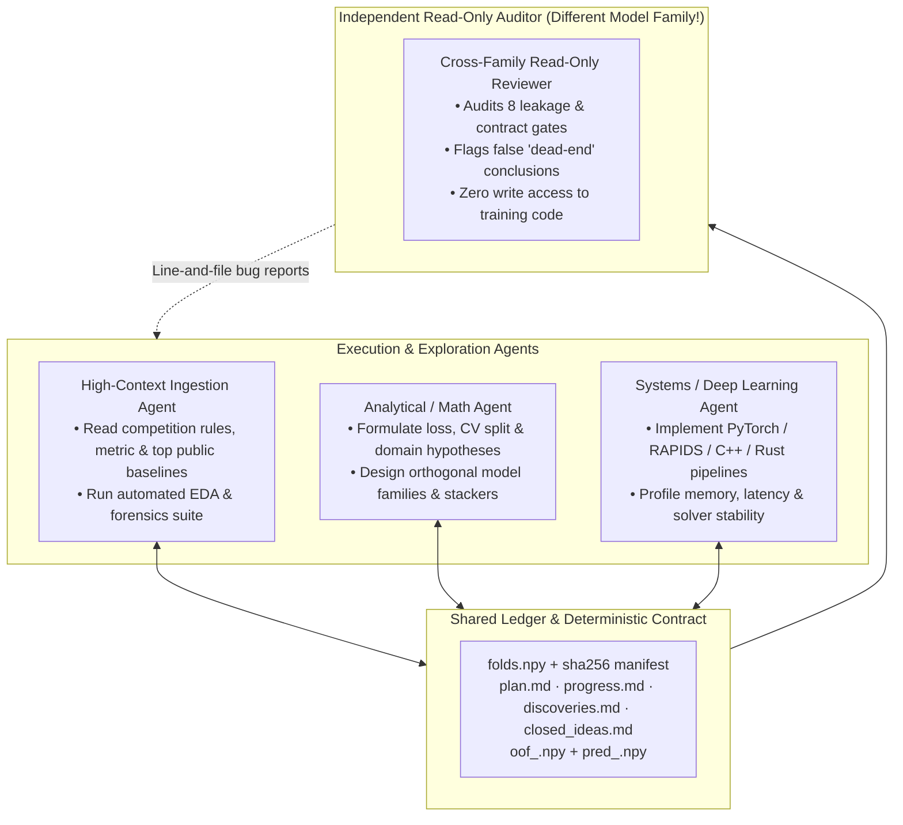

# Autonomous Multi-LLM Competitive Kaggle Workflow

A domain-neutral engineering runbook for orchestrating frontier coding agents across competitive ML campaigns—synthesizing battle-tested practices from the **KGMON Playbook** (1st Place [S6E3](../tabular/playground-s6e3-customer-churn.md), 2nd Place [S6E5](../tabular/playground-s6e5-f1-pit-stops.md)), **Multi-Leg Agent Relays** (1st Place [S6E9](../tabular/playground-s6e9-will-buy-ev.md)), **Cross-Family Independent Auditing** (6th Place [S6E9](../tabular/playground-s6e9-will-buy-ev.md)), **Dual-Agent `/goal` Loops** (4th Place [S6E10](../tabular/playground-s6e10-airline-satisfaction.md)), and **Autonomous Optimization Factories** (1st & 7th Place [NeuroGolf 2026](../optimization/neurogolf-2026.md)).

---

## 1. Multi-LLM Role Specialization & Cross-Family Architecture

Relying on a single LLM to hypothesize, write pipelines, and audit its own work creates correlated cognitive blind spots (e.g., silent inner-fold leakage or premature abandonment of strong model families). High-performing agentic campaigns separate **breadth, reasoning, implementation, and independent verification**:



### The Cross-Family Auditor Principle
- **Rule**: Pair a worker agent with an **independent read-only auditor from a different model family** (e.g., Claude Code executing + read-only Codex CLI auditing, or vice versa).
- **Why**: Self-auditing inherits the same blind spots that introduced the bug. Running an independent reviewer in read-only mode catches subtle leakage (e.g., fold misalignment, unnested target stats, or premature "dead-end" declarations on valuable residual/feature families) without risking unwanted code edits.

---

## 2. The 7-Phase Autonomous Competitive ML Lifecycle

| Phase | Objective | Key Deliverables & Guardrails |
| :--- | :--- | :--- |
| **1. Contract & Forensics** | Lock evaluation metric, runtime limits, CV split, and data-regime diagnosis | Saved `folds.npy`, adversarial shift report, missingness/outlier/leakage audit |
| **2. Uniform Baseline Harness** | Build a clean, fast baseline and standardize I/O across all future experiments | Single evaluation script verifying shape, NaNs, fold hash, and honest OOF metric |
| **3. Feature & Representation Exploration** | Run hypothesis-driven experiments matched to data regime (real-world physics vs. synthetic artifacts vs. multimodal embeddings) | Track every experiment in a shared ledger (`CV delta`, fold wins `k/K`, wall time) |
| **4. Multi-Family Model Zoo** | Train genuinely orthogonal architectures on the **exact same saved folds** | Paired `oof_<id>.npy` & `pred_<id>.npy` across GBDTs, NNs, linear/GAM, TFMs, etc. |
| **5. Nested Selection & Regularized Stacking** | Combine uncorrelated streams without meta-overfitting | Nested-CV $L_2$/$L_1$ linear or metric-exact meta-learner; compare all-stream vs. pruned selection |
| **6. Safe Distillation & Post-Processing** | Test fold-isolated soft pseudo-labeling, calibration, or metric-exact decoding | Only keep PP/PL that wins across folds on strictly honest nested CV |
| **7. Final Retraining & Hedge Audit** | Multi-seed stabilization / calibrated full-fit retraining + 2-submission hedge check | Verify Clark (1961) decorrelation ($\rho \le 0.98$, $\Delta < 2\sigma$) before selecting final pair |

---

## 3. The 2-Stage "Explore Fast, Confirm Strictly" Funnel

Running full 5-fold (or 10-fold) CV with heavy multi-seed bagging on every early idea kills iteration velocity. Decouple fast hypothesis screening from strict promotion:

1. **Stage 1 — Cheap Declared Screen (`Fold 0 → Fold 1`)**:
   - Evaluate a candidate feature block, loss, or backbone on **Fold 0** against a matched baseline on identical preprocessing.
   - If positive, confirm on **Fold 1**. Discard ~80% of dead ends in minutes without burning cluster hours.
   - *Discipline*: *"Park the exact recipe that failed, not the whole idea"*—record exact hyperparameters/epochs in `closed_ideas.md` so a stronger variant is not prematurely blacklisted.
2. **Stage 2 — Strict Nested Finalist Gate**:
   - Train full $K$-fold CV on the shared split and test marginal contribution inside the nested meta-stacker.
   - Promote only if the candidate clears a pre-registered gate (e.g., positive pooled CV gain, **$\ge 4/5$ folds improved**, worst-fold regression bounded, and passes all 8 auditor gates).

---

## 4. Multi-Leg Relay & Shared Memory Protocol

For multi-day or multi-agent campaigns, prevent context decay and duplicated work by maintaining lightweight, append-only workspace memory files:
- **`folds.npy` + `fold_hash.txt`**: Immutable split indices shared by every script and agent.
- **`plan.md`**: Active hypothesis queue ranked by expected CV lift per GPU-hour.
- **`progress.md` / `local_leaderboard.md`**: Append-only ledger recording `[model_id, family, cv_score, fold_scores, stack_delta, runtime, artifact_paths]`.
- **`discoveries.md` & `closed_ideas.md`**: Verified forensics facts vs. rejected recipes (including *why* and under what budget they failed).

---

## 5. Eight Pre-Submission Operational Guardrails

Enforce these checks programmatically in CI/test scripts and via the independent read-only auditor:

1. **Zero Feature Leakage**: All target encodings, scalers, imputers, PCA/DAE latents, and base margins fit strictly inside outer training folds (or exclusively on independent external data).
2. **No Scored-Fold Selection Bias**: Hyperparameter sweeps, feature pruning, and ensemble weights are validated inside nested CV—not cherry-picked on the same OOF labels used for reporting.
3. **Deterministic Shape & Integrity Assertions**:
   ```python
   assert oof.shape[0] == len(train_df), f"OOF length mismatch: {oof.shape[0]} vs {len(train_df)}"
   assert test_pred.shape[0] == len(test_df), f"Test length mismatch: {test_pred.shape[0]} vs {len(test_df)}"
   assert np.isfinite(oof).all() and np.isfinite(test_pred).all(), "NaN/Inf detected!"
   ```
4. **Exact Row Ordering Preservation**: Verify `id` alignment before saving OOFs and submissions (`assert (sub[id_col].values == sample_sub[id_col].values).all()`).
5. **Stacker Nesting Integrity**: Base predictions, fold calibrations, and meta-learners share one nested split with zero train-fold leakage.
6. **Zero Public-LB Feedback Fitting**: Never sweep blend weights, thresholds, or feature subsets directly against Public LB feedback.
7. **Strict Pseudo-Label Provenance**: Any soft test pseudo-labels used in fold $k$ must originate from a teacher trained strictly without validation fold $k$.
8. **Fold-Hash & Solver Convergence Parity**: Hash `folds.npy` (SHA-256) into every artifact metadata JSON; enforce tight stacker tolerances (`tol=1e-8`, logit clipping `[-30, 30]`) and transactional file writes so broken runs never overwrite best artifacts.

---

## 6. Reusable Agent Prompting Templates

Replace bracketed placeholders with the active competition's verified contract:

### Template A: Forensics & Leak-Free Baseline Setup
```markdown
Analyze [COMPETITION_NAME] ([TASK_TYPE], metric: [METRIC], target: [TARGET_COL]):
1. Verify exact schema, row counts, missingness rates, ID/group keys, and target distribution.
2. Run 3-fold OOF adversarial validation (train vs. test) overall and per feature; flag any column with OOF AUC > 0.65.
3. Create and freeze an immutable CV split ([CV_SCHEME]) saved to `artifacts/folds.npy` with its SHA-256 hash.
4. Build a clean baseline ([BASELINE_MODEL]) logging per-fold and pooled OOF [METRIC], saving `oof_baseline.npy` and `pred_baseline.npy`.
5. Save a short forensics summary to `discoveries.md`.
```

### Template B: Orthogonal Model Family Exploration (2-Stage Funnel)
```markdown
Implement a modular [MODEL_FAMILY] pipeline using the locked split in `artifacts/folds.npy`:
1. Keep all scalers, encoders, and imputers strictly inside each training fold.
2. Screen on Fold 0 (and Fold 1 if Fold 0 beats the matched baseline by > [MIN_DELTA]).
3. Only if both screen folds pass, run full [K]-fold training, save paired `oof_[NAME].npy` and `pred_[NAME].npy` with shape/NaN/hash assertions, and append CV + fold deltas to `local_leaderboard.md`.
```

### Template C: Independent Read-Only Pre-Submission Audit
```markdown
Audit `src/` and `artifacts/` in READ-ONLY mode before generating final submissions:
1. Check all 8 anti-leakage gates (nested encoders, fold-isolated PL teachers, exact fold-hash match, ID alignment, NaN/Inf bounds, stacker nesting).
2. Inspect `closed_ideas.md` for any promising families abandoned after an under-trained or buggy single recipe.
3. Verify the two candidate final submissions satisfy Clark's hedging rule (Spearman rho <= 0.98 and competitive CV gap).
Report concrete findings with exact file paths and line numbers; do not modify files.
```

---

## 7. Competition Case Studies Demonstrating This Workflow

- **Tabular Multi-LLM Scaling & KGMON Playbook**: [Playground S6E3 (1st Place, 850 models)](../tabular/playground-s6e3-customer-churn.md) · [Playground S6E5 (2nd Place Codex YOLO, 219 models)](../tabular/playground-s6e5-f1-pit-stops.md)
- **Multi-Leg Relays, Dual-Agent Auditors & `/goal` Loops**: [Playground S6E9 (1st & 6th Place)](../tabular/playground-s6e9-will-buy-ev.md) · [Playground S6E10 (1st & 4th Place)](../tabular/playground-s6e10-airline-satisfaction.md)
- **Agentic RL & Exact Optimization Factories**: [Orbit Wars (1st Place Codex RL)](../reinforcement-learning/orbit-wars.md) · [NeuroGolf 2026 (1st & 7th Place Multi-Agent Factories)](../optimization/neurogolf-2026.md)
